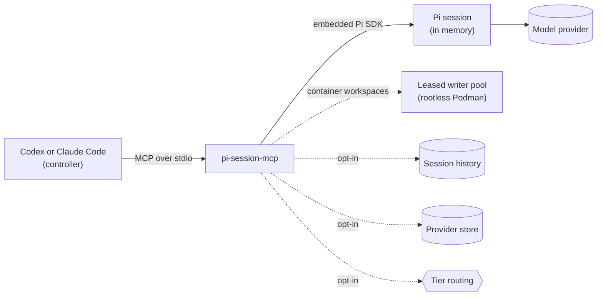

# pi-session-mcp

[](https://github.com/plagor44-ux/pi-session-mcp/actions/workflows/ci.yml)
[](https://www.npmjs.com/package/pi-session-mcp)
[](https://nodejs.org)
[](LICENSE)

**Let Codex or Claude Code delegate work to [Pi](https://github.com/earendil-works/pi) coding-agent sessions, under rules that you set.**

Pi Session MCP is a local, stdio-only [Model Context Protocol](https://modelcontextprotocol.io) (MCP) server. The client never chooses a directory, a model or a permission level. It picks from workspace and execution-profile aliases that you define in a local configuration file, then starts a session, sends prompts, polls the turn and closes the session. The server embeds the Pi SDK, keeps sessions in memory and talks only over stdin and stdout.

> Pi Session MCP is an independent project. It is not affiliated with or endorsed by the makers of Pi, OpenAI or Anthropic. Product names are used only to describe compatibility.

> **Status: pre-1.0.** Version 0.21.0 is for Linux and macOS with Codex CLI or Claude Code. Each release passes the provider-free checks. The last full live cycle with both clients on a release ran on 0.16.1; none has run on 0.21.0, and the [0.21.0 acceptance record](docs/acceptance.md#v0210-pre-release-acceptance) lists what is not established. A `coding` profile is not an operating-system sandbox; the [threat model](docs/threat-model.md) states the limits.

[Example](#example-a-second-opinion) · [Quick start](#quick-start) · [Status](#status) · [Security model](#security-model)



## Example: a second opinion

With the server registered, ask Codex or Claude Code in plain language:

```text
Get a second opinion from a Pi worker through the pi-session-mcp tools.
List the configured aliases with pi_capabilities_get. Start a session on the
workspace alias for this repository with the default read-only execution
profile. Ask the worker to review src/parser.ts and its tests for correctness
bugs and unhandled edge cases. Poll the turn until it is finished, close the
session, and report the findings with file and line. Check each finding
against the code before you act on it.
```

Replace `src/parser.ts` with a file of yours. The prompt needs:

- the package installed and registered with your client ([Quick start](#quick-start));
- a configuration that names the repository as a workspace alias and has a read-only execution profile. One read-only profile is the default, so the prompt names none;
- authentication for that profile's provider: an account sign-in (`pi-session-mcp-provider auth login`) or a key in the [provider store](docs/installation.md#provider-credentials-and-custom-providers).

The prompt is a request to your client, and the client's configuration decides what happens: the model it runs, whether it loaded the orchestration skill, and which tool calls it makes without asking you. The server enforces the configured aliases, the profile's tool allowlist and the limits of a turn. It cannot make either model follow the prompt, and the worker's answer can be wrong. The built-in tools of a read-only profile read files inside the workspace and run no commands unless the profile opts into the sandboxed shell, so name files instead of asking for a `git diff`. Tools that you grant to a profile from extensions or external MCP servers are outside that limit and may write or run commands; for this example, use a profile without them or with grants you have vetted.

## Why use it

- **A second model inside your agent.** A read-only Pi session on another model reviews a change or answers a question about a codebase, and your main agent reads the answer.
- **Bulk reading stays out of the main context.** Pi does the exploring; only its final answer returns, capped at 64 KiB.
- **Work goes to a model you choose.** An execution profile binds a provider, a model and a thinking level, so routine work can run on a local or cheaper model.
- **Follow-ups keep their context.** A session stays open across prompts.
- **You set the limits.** The client selects aliases only. The default profile is read-only, and profiles grant exactly the skills and external MCP tools you list.
- **Predictable to automate.** Sessions and turns have few states and stable error codes. Errors and the session, turn and capability metadata carry no paths, credentials, prompts or raw provider errors. The worker's answer, `assistantText`, is model output and comes back unsanitized.

It is not the right tool when you want to work with Pi yourself (run Pi directly), when you need remote access, several users or sessions that survive a restart, or when you need to contain untrusted code: a `coding` profile limits Pi's tools, but it is not an operating-system sandbox.

## Quick start

On Linux or macOS with Node.js 22.19.0 or newer, download the installer of the latest release and check it:

```sh
base=https://github.com/plagor44-ux/pi-session-mcp/releases/latest/download
curl -fsSLO "$base/install.sh" && curl -fsSLO "$base/install.sh.sha256" &&
  sha256sum -c install.sh.sha256
```

On macOS, use `shasum -a 256 -c install.sh.sha256` instead of `sha256sum -c install.sh.sha256`. For a fixed version, replace `latest/download` with `download/v<version>`. This README describes [v0.21.0](https://github.com/plagor44-ux/pi-session-mcp/releases/tag/v0.21.0).

The checksum comes from the same release as the script. A match shows that the two files belong together, which catches a damaged or incomplete download. It does not prove who published the script, because whoever can replace one file can replace both. Read `install.sh` before you run it. It is short: it checks the platform and the Node.js version, runs `npm install -g pi-session-mcp@<version>` with the version written in the script unless that version is installed already, and starts `pi-session-mcp-setup --guided --apply`. It refuses to upgrade a different installed version.

```sh
sh install.sh
```

The script pins the package version, and the package pins its direct dependencies. npm resolves the transitive dependencies at install time within the ranges those dependencies declare. For the dependency tree the maintainers tested, [install from a release tag](docs/installation.md#from-a-release-tag) with `npm ci`.

The script then runs the guided setup. The interview proposes profiles from Pi's offline model catalog and asks before it probes a provider, changes an existing configuration or allows host writes. You sign in or store keys yourself; setup does not read, print or store a credential. When you apply on an interactive terminal, the interview first offers, for each provider you name, to sign in to a provider account with `pi-session-mcp-provider auth login <provider>` or to store an API key with `pi-session-mcp-provider auth set <provider>`. A sign-in runs Pi's own dialogue on your terminal and leaves the token in Pi's credential store. The key command prompts for an API key with echo off and stores it in Pi Session MCP's own [provider store](docs/installation.md#provider-credentials-and-custom-providers). Setup receives only the command's exit status. Answer no, the default, and setup leaves every credential source as it is.

- Plan without writes, with the package installed: `pi-session-mcp-setup --guided`.
- Without the script: install [from npm](docs/installation.md#from-npm) or [from a release tag](docs/installation.md#from-a-release-tag), then [configure](docs/installation.md#2-configure) and [register a client](docs/installation.md#4-register-a-client) by hand.
- Non-interactive or agent-driven installs: [agent guide](docs/agent-install.md).
- Configuration format: [Configure](docs/installation.md#2-configure).
- Upgrades and removal: [Upgrade](docs/installation.md#upgrade) and [Remove](docs/installation.md#remove).

## Tools

| Tool | Purpose |
| --- | --- |
| `pi_capabilities_get` | List the configured workspace and execution-profile aliases. |
| `pi_session_start` | Start a session for one workspace alias and one execution-profile alias. |
| `pi_session_list` | List the sessions of this server process. |
| `pi_session_get` | Read one session. |
| `pi_session_prompt` | Send a prompt and get a running turn back. |
| `pi_turn_get` | Poll a turn until it is `completed`, `failed` or `aborted`. |
| `pi_session_abort` | Abort a running turn. |
| `pi_session_close` | End a session and release its resources. |

The [tool contracts](docs/tool-contracts.md) define every field, state and error code. The package also ships an orchestration skill for the controlling agent, which setup installs into Claude Code and Codex.

## Features

| Feature | What it does | Docs |
| --- | --- | --- |
| Execution modes | Each repository is `read-only`, `host`, `container` or a `snapshot` review slot. `host` coding needs an explicit host-write acceptance; an alias without a mode keeps legacy host coding and Doctor warns about it. | [Execution modes](docs/execution-modes.md) |
| Leased writer pool | On Linux, each coding session on a container workspace leases a rootless-Podman full-clone writer through the one host registration. Setup collects and resets writers; no reconnect is needed after reset, finish or recreate. | [ADR 0012](docs/adr/0012-leased-writer-pool.md) |
| Hardened read-only profiles | Read-only sessions read only inside their workspace and selected skills. On Linux they can opt into a bubblewrap shell without network, home or host writes. | [ADR 0013](docs/adr/0013-hardened-read-only-profiles.md) |
| Pi skills | Profiles select role skills (implementation, review, your own) from a catalog in your configuration. | [Pi skills](docs/skills.md) |
| External MCP tools | Profiles grant individual tools of local stdio MCP servers, and nothing else from them. | [Session MCP](docs/session-mcp.md) |
| Controller wake | Content-free turn events let a Claude Code hook wake the controller instead of polling. | [Wake the controller](docs/installation.md#wake-the-controller-claude-code) |
| Review snapshots | Read-only reviews on a verified, fixed commit. | [ADR 0015](docs/adr/0015-review-snapshots.md) |
| Session history | Opt-in, redacted local SQLite record of sessions, with a CLI for listing, verdicts, queries and export. | [Session history](docs/session-history.md) |
| Tier routing | Opt-in server-side choice of a profile within a tier (`ultra`, `hightech`, `medium`, `low`), manual or learning from history. | [Operate routing](docs/installation.md#operate-routing) |
| Doctor and setup | An offline health check, and reproducible registration, verification and removal for each client. | [Client setup](docs/client-setup.md) |
| Provider CLI | `pi-session-mcp-provider` manages local provider definitions and each provider's credential source (Pi's login, a stored API key or none), and signs in to and out of provider accounts through the bundled Pi. | [Provider credentials](docs/installation.md#provider-credentials-and-custom-providers) |

## Status

The package version is **0.21.0**.

| | |
| --- | --- |
| Stability | Pre-1.0. Tools, fields, states and error codes change only in a new minor release. |
| Platforms | Linux and macOS with Node.js 22.19.0 or newer. CI covers macOS 15 and 26 on Apple silicon; Intel Macs are untested. Setup refuses other platforms with `platform_unsupported`. |
| Clients | Codex CLI and Claude Code. Setup accepts a client whose public `mcp` command output matches the expected contract, without pinning versions. |
| Acceptance | Every release passes the provider-free checks. The last full live two-client cycle on a release ran on 0.16.1 with Pi SDK 1.5.0 ([record](docs/evaluation/level3-2026-11-02/README.md)). A later cycle ran on the `main` commit `93980d9` with Pi SDK 1.5.2 ([record](docs/evaluation/level3-2026-11-10/README.md)), before the release commits of 0.20.1 and 0.21.0; it is evidence for that commit only, and neither release has a cycle of its own. For 0.21.0 the [acceptance record](docs/acceptance.md#v0210-pre-release-acceptance) names what is not established: a full live cycle on the release, a turn against a real provider on the release, guided setup's sign-in offer, a routed session start, and macOS outside CI. The levels are defined in [Acceptance](docs/acceptance.md). |
| Out of scope | HTTP, a web UI, resume, remote access and multi-user behavior. One trusted local MCP peer talks to one server process. |

## Security model

- **Local and single-peer.** No network listener and no daemon. Sessions live in memory and end with the server process; nothing restores them. The opt-in [session history](docs/session-history.md) keeps a record of sessions for reading, redacted on a best-effort basis. The opt-in provider store keeps credential sources, API keys and custom provider definitions, and no session content.
- **Aliases instead of paths.** No tool accepts a working directory, a model, a provider or a credential.
- **No credential input over MCP.** By default each built-in provider uses Pi's own login (`inherit`); a provider you define yourself has no credential until you store a key. Pi Session MCP resolves Pi's login through the Pi SDK and does not print it or put it into errors or metadata. `pi-session-mcp-provider auth set` can store an API key for one provider in a local store, protected by file permissions (`0700` directory, `0600` files) and not encrypted; that key then replaces Pi's login for that provider. `pi-session-mcp-provider auth login` runs Pi's own sign-in dialogue on your terminal and receives only Pi's exit status, never the token. The token stays in Pi's credential store, where sessions resolve it like any other Pi login. `auth logout` deletes Pi's local entry and revokes nothing at the provider. A container writer receives the credentials of its selected providers and no others, an OAuth entry without its refresh token, and code that runs in that writer can read them. See [provider credentials](docs/installation.md#provider-credentials-and-custom-providers) and [ADR 0021](docs/adr/0021-provider-credentials.md).
- **Explicit policy file.** The configuration comes only from `PI_SESSION_MCP_CONFIG`, never from the client's working directory.
- **Sanitized errors and metadata.** Errors are stable codes, and session, turn and capability metadata are whitelists. They carry no paths, prompts, raw provider errors, credentials or credential locations.
- **Unsanitized answers.** `assistantText` is the worker model's output, returned as written and capped at 64 KiB. It can repeat workspace content, absolute paths and any secret the worker read. Treat it as sensitive.
- **Fail closed.** Unknown fields, unknown aliases, unexpected client output and divergent registrations are rejected, not repaired.
- **Bounded waiting.** Session creation, prompt acceptance, abort, close and shutdown have fixed deadlines.

The [threat model](docs/threat-model.md) states the assumptions and limits, including what a `coding` profile does not protect against and what code in a container writer can do with the credentials it receives.

## Documentation

| Operate | Contract and design | Maintain |
| --- | --- | --- |
| [Installation](docs/installation.md) | [Tool contracts](docs/tool-contracts.md) | [Acceptance](docs/acceptance.md) |
| [Agent install guide](docs/agent-install.md) | [Architecture](docs/architecture.md) | [Releasing](docs/releasing.md) |
| [Client setup reference](docs/client-setup.md) | [Threat model](docs/threat-model.md) | [Roadmap](docs/roadmap.md) |
| [Execution modes](docs/execution-modes.md) | [Setup lifecycle design](docs/client-setup-design.md) | [Profile evaluation](docs/evaluation/README.md) |
| [Pi skills](docs/skills.md) | [Doctor contract](docs/doctor-design.md) | [Contributing](CONTRIBUTING.md) |
| [Session MCP tools](docs/session-mcp.md) | [Decision records](docs/adr/README.md) | [Security policy](SECURITY.md) |
| [Session history](docs/session-history.md) | | [Changelog](CHANGELOG.md) |

## Development

```bash
npm ci
npm run typecheck
npm run build:cli
NODE_OPTIONS=--unhandled-rejections=strict npm test
npm run build
```

These are the CI checks. Tests use a fake Pi adapter or a scripted model and need no provider credentials. Every direct dependency is pinned exactly. A nightly canary tests the unchanged sources against the newest Pi SDK. Rules for contributors and coding agents are in [AGENTS.md](AGENTS.md); to run the server by hand or with the MCP Inspector, see [client setup](docs/client-setup.md#run-the-server-by-hand).

## License

[MIT](LICENSE)
