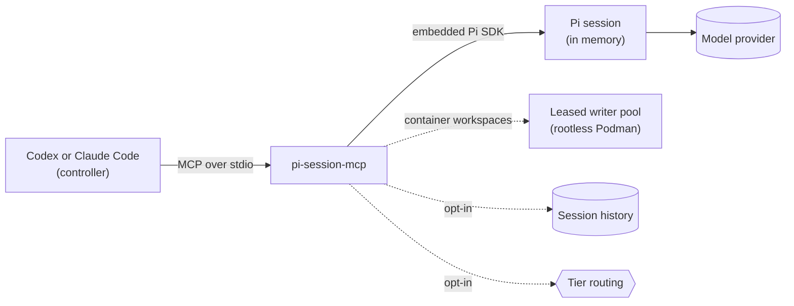

# pi-session-mcp

[](https://github.com/plagor44-ux/pi-session-mcp/actions/workflows/ci.yml)
[](https://www.npmjs.com/package/pi-session-mcp)
[](https://nodejs.org)
[](LICENSE)

**Let Codex or Claude Code delegate work to [Pi](https://github.com/earendil-works/pi) coding-agent sessions, under rules that you set.**

Pi Session MCP is a local, stdio-only [Model Context Protocol](https://modelcontextprotocol.io) (MCP) server. The client never chooses a directory, a model or a permission level. It picks from workspace and execution-profile aliases that you define in a local configuration file, then starts a session, sends prompts, polls the turn and closes the session. The server embeds the Pi SDK, keeps sessions in memory and talks only over stdin and stdout.

> Pi Session MCP is an independent project. It is not affiliated with or endorsed by the makers of Pi, OpenAI or Anthropic. Product names are used only to describe compatibility.



## Why use it

- **A second model inside your agent.** A read-only Pi session on another model reviews a change or answers a question about a codebase, and your main agent reads the answer.
- **Bulk reading stays out of the main context.** Pi does the exploring; only its final answer returns, capped at 64 KiB.
- **Work goes to a model you choose.** An execution profile binds a provider, a model and a thinking level, so routine work can run on a local or cheaper model.
- **Follow-ups keep their context.** A session stays open across prompts.
- **You set the limits.** The client selects aliases only. The default profile is read-only, and profiles grant exactly the skills and external MCP tools you list.
- **Predictable to automate.** Sessions and turns have few states and stable error codes. Results contain no paths, credentials, prompts or raw provider errors.

It is not the right tool when you want to work with Pi yourself (run Pi directly), when you need remote access, several users or sessions that survive a restart, or when you need to contain untrusted code: a `coding` profile limits Pi's tools, but it is not an operating-system sandbox.

## Quick start

On Linux or macOS with Node.js 22.19.0 or newer:

```sh
base=https://github.com/plagor44-ux/pi-session-mcp/releases/latest/download
curl -fsSLO "$base/install.sh" && curl -fsSLO "$base/install.sh.sha256" &&
  sha256sum -c install.sh.sha256 && sh install.sh
```

On macOS, use `shasum -a 256 -c install.sh.sha256` instead of `sha256sum -c install.sh.sha256`. The `&&` chain runs the installer only after both downloads and the checksum succeeded.

The script installs its exact pinned version and runs the guided setup. The interview proposes profiles from Pi's offline model catalog and asks before it probes a provider, changes an existing configuration or allows host writes. You log in to providers yourself through the package's Pi binary; setup never asks for a credential.

- Plan without writes: `pi-session-mcp-setup --guided`.
- Non-interactive or agent-driven installs: [agent guide](docs/agent-install.md).
- Configuration format: [Configure](docs/installation.md#2-configure).
- Manual installation, upgrades and removal: [installation guide](docs/installation.md).

## Tools

| Tool | Purpose |
| --- | --- |
| `pi_capabilities_get` | List the configured workspace and execution-profile aliases. |
| `pi_session_start` | Start a session for one workspace alias and one execution-profile alias. |
| `pi_session_list` | List the sessions of this server process. |
| `pi_session_get` | Read one session. |
| `pi_session_prompt` | Send a prompt and get a running turn back. |
| `pi_turn_get` | Poll a turn until it is `completed`, `failed` or `aborted`. |
| `pi_session_abort` | Abort a running turn. |
| `pi_session_close` | End a session and release its resources. |

The [tool contracts](docs/tool-contracts.md) define every field, state and error code. The package also ships an orchestration skill for the controlling agent, which setup installs into Claude Code and Codex.

## Features

| Feature | What it does | Docs |
| --- | --- | --- |
| Execution modes | Each repository is `read-only`, `host`, `container` or a `snapshot` review slot. `host` coding needs an explicit host-write acceptance; an alias without a mode keeps legacy host coding and Doctor warns about it. | [Execution modes](docs/execution-modes.md) |
| Leased writer pool | On Linux, each coding session on a container workspace leases a rootless-Podman full-clone writer through the one host registration. Setup collects and resets writers; no reconnect is needed after reset, finish or recreate. | [ADR 0012](docs/adr/0012-leased-writer-pool.md) |
| Hardened read-only profiles | Read-only sessions read only inside their workspace and selected skills. On Linux they can opt into a bubblewrap shell without network, home or host writes. | [ADR 0013](docs/adr/0013-hardened-read-only-profiles.md) |
| Pi skills | Profiles select role skills (implementation, review, your own) from a catalog in your configuration. | [Pi skills](docs/skills.md) |
| External MCP tools | Profiles grant individual tools of local stdio MCP servers, and nothing else from them. | [Session MCP](docs/session-mcp.md) |
| Controller wake | Content-free turn events let a Claude Code hook wake the controller instead of polling. | [Wake the controller](docs/installation.md#wake-the-controller-claude-code) |
| Review snapshots | Read-only reviews on a verified, fixed commit. | [ADR 0015](docs/adr/0015-review-snapshots.md) |
| Session history | Opt-in, redacted local SQLite record of sessions, with a CLI for listing, verdicts, queries and export. | [Session history](docs/session-history.md) |
| Tier routing | Opt-in server-side choice of a profile within a tier (`ultra`, `hightech`, `medium`, `low`), manual or learning from history. | [Operate routing](docs/installation.md#operate-routing) |
| Doctor and setup | An offline health check, and reproducible registration, verification and removal for each client. | [Client setup](docs/client-setup.md) |
| Provider CLI | `pi-session-mcp-provider` manages local provider definitions and credential sources offline. | [Provider credentials](docs/installation.md#provider-credentials-and-custom-providers) |

## Status

The package version is **0.20.0**.

| | |
| --- | --- |
| Stability | Pre-1.0. Tools, fields, states and error codes change only in a new minor release. |
| Platforms | Linux and macOS with Node.js 22.19.0 or newer. CI covers macOS 15 and 26 on Apple silicon; Intel Macs are untested. Setup refuses other platforms with `platform_unsupported`. |
| Clients | Codex CLI and Claude Code. Setup accepts a client whose public `mcp` command output matches the expected contract, without pinning versions. |
| Acceptance | Every release passes the provider-free checks. The last full live two-client cycle ran on 0.16.1 with Pi SDK 1.5.0; see [Acceptance](docs/acceptance.md). |
| Out of scope | HTTP, a web UI, resume, remote access and multi-user behavior. One trusted local MCP peer talks to one server process. |

## Security model

- **Local and single-peer.** No network listener and no daemon. Sessions live in memory and end with the server process. The opt-in session history records redacted sessions but cannot restore them.
- **Aliases instead of paths.** No tool accepts a working directory, a model, a provider or a credential. Pi's existing local authentication is reused and never stored, printed or returned.
- **Explicit policy file.** The configuration comes only from `PI_SESSION_MCP_CONFIG`, never from the client's working directory.
- **Sanitized results.** Errors are stable codes without paths, prompts, provider errors or credential locations. `assistantText` can repeat workspace content and is sensitive.
- **Fail closed.** Unknown fields, unknown aliases, unexpected client output and divergent registrations are rejected, not repaired.
- **Bounded waiting.** Session creation, prompt acceptance, abort, close and shutdown have fixed deadlines.

The [threat model](docs/threat-model.md) states the assumptions and limits, including what a `coding` profile does not protect against.

## Documentation

| Operate | Contract and design | Maintain |
| --- | --- | --- |
| [Installation](docs/installation.md) | [Tool contracts](docs/tool-contracts.md) | [Acceptance](docs/acceptance.md) |
| [Agent install guide](docs/agent-install.md) | [Architecture](docs/architecture.md) | [Releasing](docs/releasing.md) |
| [Client setup reference](docs/client-setup.md) | [Threat model](docs/threat-model.md) | [Roadmap](docs/roadmap.md) |
| [Execution modes](docs/execution-modes.md) | [Setup lifecycle design](docs/client-setup-design.md) | [Profile evaluation](docs/evaluation/README.md) |
| [Pi skills](docs/skills.md) | [Doctor contract](docs/doctor-design.md) | [Contributing](CONTRIBUTING.md) |
| [Session MCP tools](docs/session-mcp.md) | [Decision records](docs/adr/README.md) | [Security policy](SECURITY.md) |
| [Session history](docs/session-history.md) | | [Changelog](CHANGELOG.md) |

## Development

```bash
npm ci
npm run typecheck
npm run build:cli
NODE_OPTIONS=--unhandled-rejections=strict npm test
npm run build
```

These are the CI checks. Tests use a fake Pi adapter or a scripted model and need no provider credentials. Every direct dependency is pinned exactly. A nightly canary tests the unchanged sources against the newest Pi SDK. Rules for contributors and coding agents are in [AGENTS.md](AGENTS.md); to run the server by hand or with the MCP Inspector, see [client setup](docs/client-setup.md#run-the-server-by-hand).

## License

[MIT](LICENSE)
