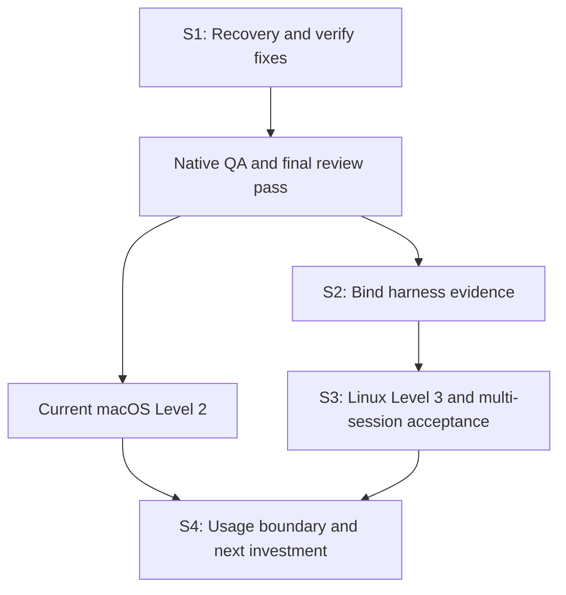

# Post-0.8.1 audit and backlog snapshot

Snapshot date: 2026-10-13. Reviewed source:
[`e462054a37505ef00e1e0c549ebab27e4db7ef55`](https://github.com/plagor44-ux/pi-session-mcp/commit/e462054a37505ef00e1e0c549ebab27e4db7ef55).
Documentation tracking: [#57](https://github.com/plagor44-ux/pi-session-mcp/issues/57).

PR #55 delivered useful stabilization and its final native CI passes. This
review nevertheless reproduced an additional, bounded data-preservation defect
in skill recovery and confirmed the diagnostic classification in issue #56.
Fix these first, then complete the missing acceptance. The evidence does not
justify a general new feature phase.

This is an English preservation of the review and plan produced on 2026-10-13.
The observations below belong to the reviewed source, not to future fixes.
Proposed tasks are separate from verified facts. Creating this record does not
fix either defect or complete any acceptance. The shorter execution index is
the [roadmap](../roadmap.md).

## Repository and source bindings

`plagor44-ux/pi-control` is archived, with no open issues or pull requests at
the snapshot. Its final PR is
[#79](https://github.com/plagor44-ux/pi-control/pull/79), main `a64a5b8`.
Its issues #31, #32 and #41 were closed as `not_planned`, not implemented.
The [closing comment on #41](https://github.com/plagor44-ux/pi-control/issues/41#issuecomment-6037099724)
explicitly names Pi Session MCP as the successor. Other software projects are
outside this review.

| Subject | Observed state |
| --- | --- |
| Main | `e462054a37505ef00e1e0c549ebab27e4db7ef55` |
| Latest PR | [#55](https://github.com/plagor44-ux/pi-session-mcp/pull/55), merged 2026-10-12 at 21:15 UTC; final head `440f2e4ccb4f7cebd88825abd8515218f4bbbdee` |
| Release | [v0.8.1](https://github.com/plagor44-ux/pi-session-mcp/releases/tag/v0.8.1), published 2026-10-12 at 22:06 UTC, or 2026-10-13 at 00:06 Europe/Berlin |
| Open issues during review | One: [#56](https://github.com/plagor44-ux/pi-session-mcp/issues/56) |
| Open PRs during review | None |
| Final PR CI | [38309093300](https://github.com/plagor44-ux/pi-session-mcp/actions/runs/38309093300), Linux, macOS 15, macOS 26 and the aggregate check passed |
| Main CI | [38309519719](https://github.com/plagor44-ux/pi-session-mcp/actions/runs/38309519719), passed |
| Tag CI | [38309738675](https://github.com/plagor44-ux/pi-session-mcp/actions/runs/38309738675), passed |
| SDK canary | [38247575455](https://github.com/plagor44-ux/pi-session-mcp/actions/runs/38247575455), passed on `de46896`, before #55 |
| Dependencies | Package 0.8.1, Pi SDK 1.1.0, MCP client/server 2.3.1; direct dependencies exactly pinned |

Open issue and PR collections, repository paths, [AGENTS.md](../../AGENTS.md),
all seven ADRs, both implementation plans, acceptance, releasing, skills,
setup design, threat model, CI and the changed runtime files and relevant
tests were inspected. Main and the open issue collection were rechecked
before delivery; main remained `e462054` and #56 remained the only open issue.
The subsequent documentation issue #57 is not part of that earlier snapshot.
Refresh main, issues, PRs and affected sources before implementation.

## Findings

### F1: recovery deletes operator changes in the transaction's trash

Severity: medium correctness/data-preservation defect. Work priority: P1.
The reproduced case needs an interrupted local skill update and subsequent
operator changes to its intermediate directory. It does not establish remote
reachability or general deletion of workspace files.

In [src/setup-skills.ts](../../src/setup-skills.ts), `recover()` at reviewed
lines 313–320 checks `.trash` only with `collectPlain()`: directory structure,
regular file types, hidden entries and tree limits. An additional regular file
passes this check; `discardTrash()` then removes it. A transaction-shaped
directory name does not prove that its current contents remain setup's own.

The isolated reproduction used the built modules from the reviewed source,
a temporary synthetic package, home and project, and `MemoryOwnershipStore`:

1. Install a synthetic v1 controller skill.
2. Provide a synthetic v2 override.
3. Throw at the existing `trash-renamed` checkpoint during the update. This
   leaves the actual pending record and intermediate directory. It simulates
   an interruption; it is not evidence of a real operating-system crash.
4. Add a regular `operator-notes.txt` with synthetic operator content inside
   that `.trash` directory.
5. In separate fresh fixtures, run `apply`, `remove` and `rollback`.

| Operation | Reported code | Operator file retained |
| --- | --- | --- |
| apply | skill_recovered | No |
| remove | skill_removed | No |
| rollback | skill_removed | No |

The [skills guide](../skills.md) and [setup lifecycle design](../client-setup-design.md)
also promise to retain modified or foreign intermediates. Existing recovery
tests cover modified backups and staging trees, plus trash with links or
hidden entries. The regular foreign-trash-file counterexample is missing.

Smallest proposed correction: delete a complete trash tree only after proving
it equals the replaced tree. Retain a partial or otherwise unprovable tree
with `skill_recovery_retained`. Continuing a partial deletion is not a reason
to risk operator files. If automatic partial recovery requires additional
durable evidence, deliver the conservative behavior first and decide that
extra scope separately. Do not introduce a broad journal abstraction as
incidental work. Align partial-trash expectations and documentation with the
actual preservation guarantee; do not weaken the counterexample.

At the audit snapshot this finding had no GitHub implementation issue.
Duplicate-check and create a focused issue before implementing R01.

### F2: verify misclassifies client and inspection failures

Severity: low diagnostic defect. Work priority: P2. Existing tracker:
[#56](https://github.com/plagor44-ux/pi-session-mcp/issues/56).

In [src/setup.ts](../../src/setup.ts), `verify()` at reviewed lines 146–149
reduces the inspection to an `equivalent` boolean. Both `unsupported` and an
inspection exception become `registration_not_equivalent`.

An isolated synthetic-adapter reproduction confirmed:

| Inspection | dry-run | verify |
| --- | --- | --- |
| unsupported | unsupported | registration_not_equivalent |
| exception | inspect_failed | registration_not_equivalent |
| absent | absent | registration_not_equivalent |
| divergent | divergent | registration_not_equivalent |

The production wrapper returns `unsupported` when client discovery fails.
The actual missing-PATH-client reproduction is reported in #56. This review
executed the orchestrator counterexample, not a real client installation.

Smallest proposed correction: preserve existing `unsupported` and
`inspect_failed` codes; reserve `registration_not_equivalent` for a genuinely
absent or divergent registration. A new `client_unavailable` code is not
necessary. Neither failure may start a mutation or MCP handshake. Preserve
Doctor, ownership and release-binding precedence, and check human/JSON output,
exit status, documentation and negative Level-2 cases.

## Review and CI limits

[CI 38307240366](https://github.com/plagor44-ux/pi-session-mcp/actions/runs/38307240366)
failed on both macOS jobs at the earlier `183d53c` head; Linux passed.
`f048144` made Linux-only harness checks platform-explicit and `0c7bad3`
named the platform in lock fail-closed cases. The final head passes the full
matrix. There is no still-failing final PR check in this observation.

GitHub returned no formal review submissions and no inline review threads
for #55. The [Codex security comment](https://github.com/plagor44-ux/pi-session-mcp/pull/55#issuecomment-6132442390)
names `183d53c`, a P0 threshold and no merge gate. It does not approve the
complete final head. The PR description reports independent local reviews;
their reports were not separately available to this review. Green CI and the
security summary do not exclude F1.

## Checks actually executed by the review

Unmodified checkout `e462054`; Linux container, Node.js 24.19.0. No real
client registrations, models or providers were used. The review itself did
not modify repository files, create commits/issues/PRs or publish a release.
The later documentation-preservation change is separate.

| Check | Result |
| --- | --- |
| npm ci | Exit 0 |
| npm run typecheck | Exit 0 |
| npm run build:cli | Exit 0 |
| NODE_OPTIONS=--unhandled-rejections=strict npm test | Exit 1: 41 files passed, 9 failed; 983 tests passed, 52 failed, 6 skipped; 4 unhandled errors |
| npm run build | Executed separately, exit 0 |
| npm audit | Exit 0; no vulnerabilities at the time of the query |
| git diff --check | Exit 0 |
| git status --short | Empty |
| Recovery reproduction | F1 confirmed for all three operations |
| Verify reproduction | F2 confirmed for unsupported and inspection exception |
| Isolated existing process-table test | createProcessTable().readable() failed in this environment |

Failures concentrate on process groups, `/proc`, kernel locks, the guardian
and dependent crash/harness tests. Direct probes gave inconsistent process
visibility. The precise cause is unresolved. The isolated process test,
`src/setup-platform.ts`, `src/setup-process.ts` and `test/process-fixture.ts`
are unchanged from the PR base. This argues against attributing all 52
failures to #55 but does not establish the cause of each failure. Do not
claim a green local acceptance or turn all failures into new product bugs.
A complete run on a supported native runner remains a gate.

## Complete clustered remainder

P1 means first or a gate for dependent usage. P2 is bounded follow-up work.
P3 needs concrete demand. **R01–R23 are roadmap identifiers, not GitHub issue
numbers.** Only #56 was already an open issue during the audit; other rows are
findings, evidence gaps or proposed maintenance tasks.

### A: correctness and local operation

| ID | Priority | Remainder | Deliverable |
| --- | --- | --- | --- |
| R01 | P1 | F1 modified-trash data loss | Focused issue and conservative fix; regular foreign file, modified existing content, complete own trash and partial trash counterexamples for apply/remove/rollback |
| R02 | P2 | F2 / #56 verify classification | Preserve existing codes; negative cases without mutation or handshake |
| R03 | P1 gate | Local full suite failed | Reproduce on native Linux; distinguish product defects from container prerequisites without retries or weaker process proofs |
| R04 | P2 | Non-exhaustive start-error list in the orchestration skill | Classify current public start codes as operator-needed, transient or unknown; never classify provider free text |

### B: evidence and orchestration

| ID | Priority | Remainder | Deliverable |
| --- | --- | --- | --- |
| R05 | P1 | No full ten-task Level-3 cycle on Pi SDK 1.x | One frozen build, both controllers, five tasks each, independent snapshots/oracles; preserve failed attempts |
| R06 | P1 gate | Final supplementary Codex abort run violated scope | Offer handshake only where needed or make it unambiguously task-bound; new run with unchanged strict scope oracles, not a wider allowed-file set |
| R07 | P2 | No live discovery of the setup-installed Codex home skill | Real discovery of a regular setup-installed copy in an isolated client home; verified revision, no required manual symlink |
| R08 | P2 | Third concurrent worker and read-only reviewer unproven live | After two-worker acceptance, two writers in separate worktrees plus a reviewer of a frozen result; scope, association, neighbor abort and close |
| R09 | P2 | Current multi-session live evidence covers Cursor workers only | Level 3 for the normal/local Pi profile actually intended for use; do not transfer Cursor evidence to other providers |
| R10 | P2 | Current macOS Level-2 path not fully accepted on real hardware | 0.8.x with both clients in isolated homes; prior Claude Code evidence does not automatically cover new skill locks/recovery, and Codex was already pending |
| R11 | P2 conditional | macOS live use beyond CI | Small real-Mac read-only smoke when needed; heavy suites and parallel inference on suitable Linux hardware |
| R12 | P3 | Real skill-update crash, customization contention and harness-analysis signal runs absent | Add only targeted evidence when operating experience warrants it; existing provider-free tests are not renamed as live evidence |

Two-session operation already has real evidence: Claude Code passed parallel
and abort; Codex passed parallel. The final Codex abort run failed only
`range:changes`, because a Cursor worker applied the handshake skill to an
unrequested file. Abort, neighbor behavior and cleanup passed. This is a
task/worker outcome, not a demonstrated session-control defect. More than two
sessions are not documented as technically impossible; their live proof is
missing.

### C: acceptance and release evidence quality

| ID | Priority | Remainder | Deliverable |
| --- | --- | --- | --- |
| R13 | P2 | Runs bind extension name/version, not package contents | Fingerprint effectively loaded extension trees before/after a run; changed contents invalidate acceptance; no published raw paths |
| R14 | P2 | Additional Codex skill sources are not bound | Bind actually active CODEX_HOME/system skill sources or demonstrably exclude them; prerequisite for R07 |
| R15 | P3 | Unreadable client start time immediately after spawn leaves no sighting | Explicit failed/unverified evidence; never infer cleanup from an absent observation |
| R16 | P2 | Strict unhandled rejections are not explicit in CI | Align the current CI test environment with the local strict command; no broad new matrix |
| R17 | P3 | npm audit is manual only | Keep the manual release gate; consider one small scheduled advisory check only after further demonstrated drift, in its own issue |
| R18 | P3 | npm publication has no provenance attestation | Consider Trusted Publishing/provenance as a separate supply-chain decision if external use makes it relevant; not a blocker for bounded local dogfooding |

The latest observed canary predates #55. A current-source canary can add
maintenance evidence, but cannot replace native full-suite or live acceptance.
It does not authorize an SDK upgrade.

### D: documentation and planning

| ID | Priority | Remainder | Deliverable |
| --- | --- | --- | --- |
| R19 | P2 | v0.8.1 post-release evidence exists only in release notes | Carry it into acceptance with the next change PR, as #55 explicitly planned; do not describe this as a forgotten release operation |
| R20 | P2 | Historical macOS/extension plans retain unchecked steps | Mark delivered/superseded work with PR references; do not reimplement it |
| R21 | P2 | No consolidated active roadmap in the successor | Short English docs/roadmap.md with actual remainder, sources and gates, under a focused issue |
| R22 | P2 | ChatGPT project instructions still describe the former repository/release sequence | Update successor, SDK, macOS, extensions/skills and current ADR ordering; do not reuse v0.3.0 or old #11–#14 as active priorities |
| R23 | P3 | Acceptance/versioning wording can be misunderstood | Distinguish targeted two-session evidence from full Level 3; clarify MCP-contract versus setup-report versioning |

R21 is the documentation created alongside this snapshot. The other rows do
not become complete merely because they are recorded here.

### E: deliberately deferred decisions

| Topic | State | Entry condition / smallest useful test |
| --- | --- | --- |
| OS/process isolation | ADR 0003; decide before real writable workspaces | Non-disposable repositories or untrusted coding content: separate architecture/threat-model issue; synthetic isolated write test |
| pi_turn_wait | No implementation now | Routinely more than about five polls per turn with pauses, or demonstrated tool/approval cost. The reported 5–7 polls per invocation do not establish the trigger |
| Persistence/resume | No demonstrated current need | Actual loss of useful work after restart; otherwise ephemeral sessions |
| HTTP/remote/mobile | No approved need | Concrete case SSH/existing remote development cannot satisfy; separate ADR/security decision |
| Finer turn_failed | Upstream-dependent | Closed public final SDK cause discriminator after retry/compaction, with positive and negative cases; no regex on raw errors |
| Multi-user, UI, credential management | Outside product scope | Separate justified product goal and ADR |
| Former pi-control #31/#32 | Closed as not_planned | No automatic reopening/migration; a current project-specific need requires separate scope |
| Former release gates and #11–#14 | Historical | Do not repeat delivered historical gates; acceptance must bind the current build |

## Plan and ADR reconciliation

| Source | Delivered state | Actual remainder |
| --- | --- | --- |
| [macOS plan, 2026-10-10](../superpowers/plans/2026-10-10-macos-setup.md), tasks 1–8 | Platform, runner/guardian, ownership, tests, EOF, CI and docs delivered by #33; #32 closed | Real Codex Mac acceptance, current 0.8.x skill paths, plan checkbox status |
| [Extension plan, 2026-10-11](../superpowers/plans/2026-10-11-pi-extensions.md), tasks 1–9 | Configuration, resolution, Doctor, stdout guard, prompt source, runtime, contracts and governance delivered by #35/#37/#44; #34 closed | Plan status and current follow-ups; no duplicate implementation |
| Extension plan, task 10 | Cursor live path documented in acceptance and #55, including Claude Code parallel/abort | Controller/platform limits in cluster B |
| [ADR 0001](../adr/0001-stdio-first.md) | Local stdio, one trusted peer | No transport project |
| [ADR 0002](../adr/0002-embedded-pi-sdk.md) | Public embedded APIs, no OS isolation | Read later approved ADR 0006/0007 expansions together |
| [ADR 0003](../adr/0003-post-mvp-maintenance.md) | Maintenance, no general feature phase | Evaluate revisit triggers using current measurements only |
| [ADR 0004](../adr/0004-client-contract-not-version.md) | Client contract rather than exact client-version allowlist | Fix #56; do not reinstate the old allowlist |
| [ADR 0005](../adr/0005-macos-setup-platform.md) | macOS with the same fence guarantee | Current native acceptance |
| [ADR 0006](../adr/0006-pi-extension-allowlist.md) | Exact locally installed profile extensions | Runtime/content evidence; no automatic install |
| [ADR 0007](../adr/0007-profile-skill-selection.md) | Operator catalog, profile-selected skills, setup-installed controller skill | F1 and actual discovery; skills neither grant rights nor guarantee task success |

## Four gated sprints

Dates are a proposal from 2026-10-13, not a capacity commitment. A delayed gate
shifts dependent work; independent documentation and Mac setup checks may
continue. Each coding task needs a focused issue first.

### Sprint 1: stability and correct diagnostics

Proposed window: October 13–14, one or two implementation sessions plus native
verification. Scope: R01, R02, R03, R19 and directly affected documentation.

Create the missing R01 issue after a duplicate check. Claude Code locally
integrates. Recovery and #56 can run in separate worktrees with read-only
review/documentation work in parallel. Run the heavy full suite only after
integration; do not overlap full suites on a small host.

- Recovery owns `src/setup-skills.ts` and dedicated recovery counterexamples.
- #56 owns `src/setup.ts` and targeted lifecycle/verify tests.
- The integrator owns shared docs, changelog, acceptance and version fields.

Exit gate:
- Modified regular trash contents remain intact under apply/remove/rollback.
- Complete own intermediates are handled correctly; unprovable partial trees
  remain with a stable report code.
- Missing clients report unsupported and inspection exceptions inspect_failed;
  neither runs a registration mutation or handshake.
- Doctor, release-binding and ownership precedence remain intact.
- Native Level 1 has no unhandled rejections; the final head passes the full
  Linux/macOS matrix and independent code review.
- Level 2 remains green on actually checked targets; new negative cases are
  recorded separately.

Delivery: one consolidated maintenance PR with separate issue commits.
0.8.2 is a possible patch candidate if the MCP contract is unchanged. The
version and pre-release evidence belong in that change PR under the current
release procedure. Merge/tag/publish remain a separate maintainer gate, not
an action performed by this plan. Do not approve if F1 remains or native
Level 1 fails.

### Sprint 2: make acceptance traceable

Proposed window: October 15–16, one or two sessions after Sprint 1. Scope:
R04, R13, R14, R16 and R19–R23 where narrowly justified. Include R15 only if a
counterexample establishes a material proof gap.

Bind effectively loaded extensions and active skill sources; do not silently
ignore unknown sources. Offer the handshake only where its task needs it.
Keep original strict scope oracles. Reconcile historical plans with delivered
PRs, maintain a short English roadmap and preserve post-release evidence.
Align strict CI. Check the current-source canary on a frozen candidate without
moving the SDK pin.

Harness evidence, controller-skill failure policy and documentation can run in
separate worktrees. One owner edits the central harness; the integrator owns
shared acceptance documentation.

Exit gate: changing a bound skill/extension after preparation invalidates a
run; installed versus linked skills are distinguishable; original failed
attempts remain recorded; every remainder has an issue or explicit entry
condition. No new runtime feature phase.

### Sprint 3: accept real usage

Proposed window: October 17–20, two or three bounded acceptance sessions, not
a broad implementation package. Scope: R05–R11. Requires Sprint 1 and the
Sprint-2 evidence bindings before the runs that depend on them.

Start on Linux with the full Level-3 matrix for both controllers at the same
frozen build. Select a normal/local Pi profile actually intended for use;
record the loaded model before/after every run and never force a model switch
on shared inference. Use synthetic coding fixtures only. Pre-register tests,
allowed files, snapshots and oracles. A scope failure remains a failed task.

Then run targeted parallel/abort scenarios for both controllers with the
appropriate Cursor profile. A fresh Codex abort must pass scope too.
Only afterwards try one small extension to two writers in separate alias
worktrees and a read-only reviewer of a frozen result. Do not begin with a
large worker matrix.

In parallel, the Mac runs only current Level 2 for both clients and a short
read-only smoke. Keep heavy suites and parallel large inference off a
resource-constrained work Mac. If a client is unavailable, retain that gate
and deliver independent Linux work.

Exit gate: meet the existing Level-3 criteria, including at least 8/10
intended outcomes without a server defect **and** every required scope,
security and cleanup condition, both client lifecycles, useful follow-ups
and verified coding. Target 10/10; the 8/10 rule never hides unauthorized
changes. Codex abort scope passes; setup's installed Codex copy is actually
read; read-only fixtures remain byte-identical; all sessions close with no
residual processes or structural leaks. Usage claims cover only tested
profiles, clients, platforms and concurrency.

### Sprint 4: decide the next investment from usage

Proposed window: October 21–23, one short evaluation. No feature implementation
without a separate justified decision.

Evaluate failures/causes, scope violations, polls per turn with real pauses,
task duration, cleanup, actual restart costs and planned non-disposable coding
workspaces. Route R12/R15/R17/R18 into one concrete follow-up or the deferred
list according to need.

If real writing is next, isolation is the first architecture question. If only
polling is costly, examine the smallest bounded-wait proposal. If no trigger
fired, continue maintenance. Persistence and remote access need their own
evidence. The strongest argument against expansion is the security and
maintenance surface it adds to a deliberately small local server.

Exit gate: documented decision, at most one next investment, a focused issue
and an appropriate ADR for scope/contract changes. No automatic roadmap to
1.0 or general release authorization.

## Dependencies

The next implementation session is Sprint 1: R01 plus #56 are the smallest
evidence-backed development step. A published tag alone is not its exit gate.
