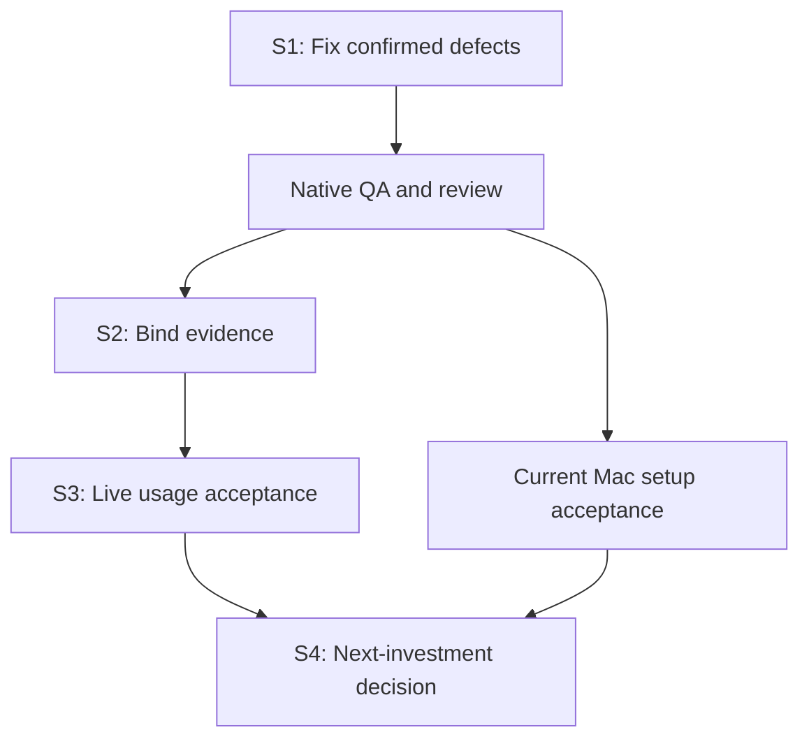

# Maintenance roadmap

Planning basis: main `e462054a37505ef00e1e0c549ebab27e4db7ef55`, 2026-10-13.
Tracking: [#57](https://github.com/plagor44-ux/pi-session-mcp/issues/57).
The complete [audit and clustered backlog](reviews/2026-10-13-post-0.8.1-audit.md)
preserves source bindings, reproductions, checks and all R01–R23 items.

PR #55 and v0.8.1 have green final native CI, but the review reproduced a
skill-recovery data-preservation defect and confirmed #56's verify diagnosis.
Fix those first, then complete real acceptance. Recording tasks does not mean
they are implemented or that their gates passed.

## Sprints and exit gates

The dates are proposed windows, not commitments. Dependent work waits for its
gate; independent Mac setup verification and documentation may run alongside.

| Sprint | Proposed window | Work | Exit gate |
| --- | --- | --- | --- |
| S1: correctness | Oct 13–14; 1–2 sessions plus native QA | R01 recovery fix, R02/#56 diagnosis, R03 native checks, R19 evidence record | Operator data preserved; correct existing codes; native Level 1, final review/CI and relevant Level 2 pass |
| S2: evidence | Oct 15–16; 1–2 sessions | R04, R13/R14 resource binding, R16 strict CI, R19–R23 documentation; R15 only if justified | Changed resources invalidate acceptance; original failures retained; remainder has issues or entry conditions |
| S3: live usage | Oct 17–20; 2–3 bounded sessions | R05–R11: same-build ten-task cycle, Codex abort scope/discovery, third/read-only worker, intended profile, current Mac acceptance | Existing Level-3 gate plus all scope/security/cleanup criteria; no claim beyond tested combinations |
| S4: decision | Oct 21–23; 1 evaluation | Usage metrics, conditional R12/R15/R17/R18 | Maintenance or at most one justified investment, with focused issue and ADR where required |

R-identifiers are planning identifiers, not GitHub issue numbers. #56 was
the only open implementation tracker at the audit snapshot. Create a focused,
duplicate-checked issue before each new implementation task. This roadmap
delivers R21's documentation; it does not close the other tasks.

## Parallel work

- S1 recovery and #56 use separate worktrees and file ownership. The
  integrator owns shared docs, changelog and release fields. Full-suite QA
  runs once on the final combined source, without overlapping heavy suites.
- S2 has one harness owner; skill policy and documentation can proceed
  independently.
- S3 live runs are sequential on each shared inference endpoint; independent
  current Mac Level-2 setup checks can run in parallel. Only after two-session
  acceptance, try two writers on separate aliases plus one read-only reviewer
  of a frozen result.
- Keep heavy suites and parallel large-model work off a constrained work Mac.

## Product boundary and deferred work

Follow [ADR 0003](adr/0003-post-mvp-maintenance.md), together with the approved
macOS, extension and skill decisions in ADRs 0005–0007. Maintain local stdio,
in-memory state and one trusted local peer.

| Topic | Entry condition |
| --- | --- |
| OS isolation | Decide before coding on non-disposable repositories or with untrusted content; profiles/skills are not an OS sandbox |
| pi_turn_wait | Measured high polling cost per turn with pauses or tool/approval cost; 5–7 polls per invocation is insufficient evidence |
| Persistence/resume | Actual loss of useful work on restart |
| HTTP/remote/mobile | Concrete need existing SSH/remote development cannot meet; separate ADR/security decision |
| Finer turn_failed | Closed public final SDK cause discriminator after retry/compaction, not error-text guessing |
| Multi-user/UI/credentials | Separate justified product scope and ADR |
| Former pi-control #31/#32 | Closed as not_planned; no automatic migration/reopening |
| Former release gates/#11–#14 | Historical; bind current acceptance to the current build |

0.8.2 is a possible S1 patch candidate only if the MCP contract remains
unchanged and its gates pass. Apply the current [release procedure](releasing.md):
version and pre-release acceptance travel in the change PR. Merge, tagging and
publication remain maintainer decisions. No release is authorized by this plan.
