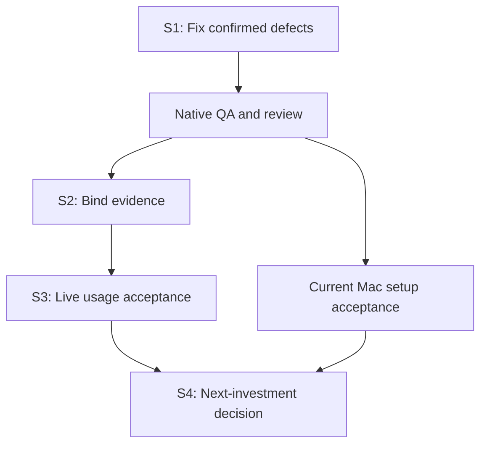

# Maintenance roadmap

Planning basis: main `e462054a37505ef00e1e0c549ebab27e4db7ef55`, 2026-10-13.
Tracking: [#57](https://github.com/plagor44-ux/pi-session-mcp/issues/57).
The complete [audit and clustered backlog](reviews/2026-10-13-post-0.8.1-audit.md)
preserves source bindings, reproductions, checks and all R01–R23 items.

PR #55 and v0.8.1 have green final native CI, but the review reproduced a
skill-recovery data-preservation defect and confirmed #56's verify diagnosis.
Both were fixed in Sprint 1; real acceptance follows. Recording tasks does not
mean they are implemented or that their gates passed.

## Current state

- 2026-10-28: [ADR 0012](adr/0012-leased-writer-pool.md) was accepted and
  implemented in #157: one host registration with a leased container writer
  pool, base-aware allocation and host-spool events. Prepared as minor release
  0.12.0 together with #151 and #154, released the same day and installed with
  a live relayed coding session; 0.12.1 fixes client-target verify (#160).
  Both machines run 0.12.1, and #151 and #154 passed their live checks. The
  opt-in `--clean all` (#162) shipped in 0.13.0.
- 2026-10-28: [ADR 0013](adr/0013-hardened-read-only-profiles.md) (#169):
  workspace-confined read tools for every read-only profile and the opt-in
  bubblewrap shell (`shell: "sandboxed"`), released in minor release 0.13.0
  together with #162, #163, #165 and #166.
- 2026-10-29: the post-0.13.0 review findings in one pull request, released in
  patch release 0.13.1:
  stale waiter-lock reclamation in the wake hook
  ([#179](https://github.com/plagor44-ux/pi-session-mcp/issues/179)), per-writer
  reconcile failures ([#180](https://github.com/plagor44-ux/pi-session-mcp/issues/180))
  and the split of `setup-writers.ts` and the largest test files
  ([#181](https://github.com/plagor44-ux/pi-session-mcp/issues/181)). #120 still
  waits for a Pi SDK release: 1.4.0 is the newest and still pins `undici` 8.10.2,
  which `npm audit` now reports with eight advisories.
- 2026-10-29: agent-driven execution-profile setup
  ([#139](https://github.com/plagor44-ux/pi-session-mcp/issues/139)), released in
  minor release 0.14.0 together with the refusal of controller skills as worker
  skills ([#188](https://github.com/plagor44-ux/pi-session-mcp/issues/188)):
  the offline model catalog `pi-session-mcp-setup --list-models`, the opt-in
  provider probe `--probe-profile <alias> --apply` (one fixed PONG turn per
  profile), and the shipped controller skill `pi-session-profiles`, with which a
  controlling agent creates, changes or retires profiles without a guided
  dialog. Recorded in [ADR 0014](adr/0014-profile-probe-and-model-catalog.md).
- 2026-10-30: [Sprint 12](sprints/2026-10-29-s12-audit-fixes.md) fixes three
  audit findings on `9d9cf8c` in one pull request, released in patch release
  0.14.1: read-only context files confined to the workspace
  ([#192](https://github.com/plagor44-ux/pi-session-mcp/issues/192)), detached
  `HEAD` collection and the release-digest gate
  ([#193](https://github.com/plagor44-ux/pi-session-mcp/issues/193)) and the
  full writer profile comparison in the relay
  ([#194](https://github.com/plagor44-ux/pi-session-mcp/issues/194)). Levels 1
  to 3 passed for the candidate. #120 still waits for a Pi SDK release.
- 2026-10-30: [Sprint 13](sprints/2026-10-30-s13-index-only-work.md) fixes the
  loss of work that exists only in a writer's Git index
  ([#200](https://github.com/plagor44-ux/pi-session-mcp/issues/200)) in one
  pull request, released in patch release 0.14.2: inspection evaluates the
  original index tree, the versioned collection digest covers it, and
  collection exports staged-only work as `<branch>-index`. The published-release Level 2 of 0.14.1 passed. The
  same loss for work that exists only in a stash entry is the follow-up
  [#202](https://github.com/plagor44-ux/pi-session-mcp/issues/202).
- 2026-10-30: #202 is fixed in one pull request, released in patch release
  0.14.2: collection exports every stash entry as `<base>-stash-<n>`, and tags,
  notes and other unexported refs must name objects the operator checkout
  already has before a writer counts as baseline or a digest is recorded.
- 2026-10-30: the published-release Level 2 of 0.14.2 passed
  ([evidence](acceptance.md#v0142-post-release-evidence)).
  [Sprint 14](sprints/2026-10-30-s14-sandbox-resource-limits.md) limits the
  sandboxed read-only shell
  ([#195](https://github.com/plagor44-ux/pi-session-mcp/issues/195)) in one
  pull request, released in patch release 0.14.3: every probe and command runs in its own
  transient systemd user scope with 1 GiB memory, no swap and 512 tasks, and
  the command is released only after the server has verified the effective
  cgroup values. Hosts without a systemd user manager or without `memory` and
  `pids` delegation lose the sandboxed shell. Open: #79, #120, #144.
- 2026-10-31: the published-release Level 2 of 0.14.3 passed
  ([evidence](acceptance.md#v0143-post-release-evidence)), and both
  installations run 0.14.3. `npm audit` additionally reports `minimatch`
  10.2.6, pinned by Pi SDK 1.4.0 (recorded in #120). Open: #79, #120, #144,
  and the evaluation issues #209 to #215.
- 2026-10-31: [Sprint 15](sprints/2026-10-31-s15-completion-kind-review-snapshots.md)
  reports how a completed turn ended (`completion`: `stop`, `output_limit` or
  `tool_use`, [#211](https://github.com/plagor44-ux/pi-session-mcp/issues/211))
  and proposes [ADR 0015](adr/0015-review-snapshots.md) for read-only reviews
  bound to one commit ([#209](https://github.com/plagor44-ux/pi-session-mcp/issues/209)),
  with a synthetic real-Git proof, in one pull request without a release.
  The maintainer accepted ADR 0015 with its detect-not-prevent contract the
  same day; implementation is
  [#217](https://github.com/plagor44-ux/pi-session-mcp/issues/217).
- 2026-10-31: [Sprint 16](sprints/2026-10-31-s16-review-snapshots.md)
  implements ADR 0015 ([#217](https://github.com/plagor44-ux/pi-session-mcp/issues/217)):
  the `snapshot` execution mode, setup-managed snapshot slots with a guardian
  fence, sessions that hold a shared lease and verify the bound commit at
  start, before every prompt and after every turn, and three Doctor checks,
  Linux only, in one pull request without a release.
- 2026-10-31: [Sprint 17](sprints/2026-10-31-s17-design-evaluations.md)
  evaluates four development ideas without changing the runtime, in one pull
  request without a release:
  - [#213](https://github.com/plagor44-ux/pi-session-mcp/issues/213):
    proposes [ADR 0016](adr/0016-writer-recovery-export.md), a recovery
    export for a writer with an unmerged index.
  - [#212](https://github.com/plagor44-ux/pi-session-mcp/issues/212):
    proposes [ADR 0017](adr/0017-turn-duration-limit.md), a per-profile
    maximum turn duration.
  - [#210](https://github.com/plagor44-ux/pi-session-mcp/issues/210): defers
    a structured worker receipt after a live comparison.
  - [#214](https://github.com/plagor44-ux/pi-session-mcp/issues/214): rejects
    a separate question channel after a live check with Claude Code and
    Codex.

  The maintainer accepted both ADRs the same day and closed #214 and #79.
- 2026-10-31: [Sprint 18](sprints/2026-10-31-s18-abort-boundary-skill.md)
  fixes the Sprint 17 follow-ups in one pull request without a release:
  `abort_timeout` on snapshot sessions
  ([#224](https://github.com/plagor44-ux/pi-session-mcp/issues/224)), the
  quoted `safe.directory` in the writer boundary after a live probe that
  showed a worker cannot configure Git filter or include drivers
  ([#222](https://github.com/plagor44-ux/pi-session-mcp/issues/222)), and the
  controller skill's `NEEDS_CONTEXT` wording
  ([#223](https://github.com/plagor44-ux/pi-session-mcp/issues/223)). A minor
  release 0.15.0 with #211 and #217 follows, then the snapshot acceptance
  [#220](https://github.com/plagor44-ux/pi-session-mcp/issues/220). Open:
  #120, #144, #212, #213, #215, #220, #221.

The explicit 2026-10-17 user request adds a bounded development-only
[token-footprint measurement](sprints/2026-10-17-token-footprint.md), following
PR #84. It does not change maintenance mode or the isolation priority below.
Live measurement requires its own current source-bound matrix/route/budget
approval; historical evaluation approvals do not apply.
Its [offline results](evaluation/token-footprint-2026-10-17/README.md) record
80 transport cases, 50 filter cases and ten adverse-report controls. The
operator-approved [M1 pilot](evaluation/token-footprint-2026-10-17/m1-pilot/README.md)
passed on 2026-10-18 on its third attempt (attempts 1 and 2 failed on harness
defects and are preserved); it measured Codex **controller** usage on one route.
Worker usage and money cost remain unknown. An A/B is proposed, not approved.

Updated 2026-10-18. Base main `612fbcb976d4563ea597e87be56123055b782c1a`
(the merge of PR #85). Sprint 5 is the
[maintenance and orchestration sprint](sprints/2026-10-18-s5-maintenance-orchestration.md).

- R21 (this roadmap) was delivered as documentation by
  [#58](https://github.com/plagor44-ux/pi-session-mcp/pull/58), which closed
  [#57](https://github.com/plagor44-ux/pi-session-mcp/issues/57).
- Sprint 1 is closed: [#61](https://github.com/plagor44-ux/pi-session-mcp/pull/61),
  merged as `b145f8c`, closed #59 (R01) and #56 (R02). See the
  [Sprint 1 file](sprints/2026-10-13-s1-correctness.md#closure).
- Sprint 2 is closed: [#69](https://github.com/plagor44-ux/pi-session-mcp/pull/69)
  was merged on 2026-10-13 as `0aae639`, after its final-head CI passed on
  Linux, macOS 15 and macOS 26. It closed #60, #62, #63, #64, #65, #66, #67
  and #68 as completed. See the [Sprint 2 file](sprints/2026-10-13-s2-evidence.md).
  The main CI run on the merge commit then failed on `macos-15` in one harness
  test that timed out on the slow runner; the tree is identical to the green
  pull-request head. Tracked as
  [#70](https://github.com/plagor44-ux/pi-session-mcp/issues/70) and fixed in
  Sprint 3.
- Sprint 3 is closed: [#75](https://github.com/plagor44-ux/pi-session-mcp/pull/75)
  was merged on 2026-10-13 as `f636e6e` with green CI on Linux, macOS 15
  and macOS 26, also on main; it closed #70 and #71. The first ten-task Level 3
  cycle on Pi SDK `1.x` was accepted (10 of 10, with the maintainer's intended
  profiles `explore-fast` and `code-deepseek`); R06 and R07 passed; R08
  passed for Codex while Claude Code failed one timing criterion
  ([#74](https://github.com/plagor44-ux/pi-session-mcp/issues/74)). R10 and R11
  are blocked on the work Mac, with a runbook. See the
  [Sprint 3 file](sprints/2026-10-13-s3-live-usage.md).
- Release 0.8.2 was merged in [#76](https://github.com/plagor44-ux/pi-session-mcp/pull/76)
  and published on 2026-10-14. It carries #59, #56, #60 and the #62 skill
  change under an unchanged MCP contract. Its published-release acceptance on
  2026-10-15 found that a fresh npm install crashes at startup
  ([#78](https://github.com/plagor44-ux/pi-session-mcp/issues/78)); the fix
  ships as 0.8.3.
- Sprint 4 decision inputs for the conditional items R12, R15, R17 and R18 are recorded in the [Sprint 4 decision inputs](sprints/2026-10-13-s4-decision-inputs.md) ([#72](https://github.com/plagor44-ux/pi-session-mcp/issues/72)): R12, R15 and R17 not met, R18 not determinable as of 2026-10-13; this is input, not the Sprint 4 decision.
- Sprint 4 is closed with its [decision](sprints/2026-10-15-s4-decision.md)
  ([#77](https://github.com/plagor44-ux/pi-session-mcp/issues/77)), taken on
  2026-10-15 before the macOS gate by maintainer decision. ADR 0003's isolation
  trigger fired, because coding profiles had written on non-disposable
  repositories. The one next investment is the isolation decision
  ([#79](https://github.com/plagor44-ux/pi-session-mcp/issues/79), ADR 0008
  Proposed), with interim operating rules until it is accepted. R12, R15 and
  R17 stay deferred (not met), R18 stays deferred (not determinable), and
  [#74](https://github.com/plagor44-ux/pi-session-mcp/issues/74) is closed as
  not planned. R10, R11 and R22 stayed open at that point; R10 and R11 were verified on 2026-10-16 (see the table below).
- Release 0.8.3 was merged in [#80](https://github.com/plagor44-ux/pi-session-mcp/pull/80)
  and published on 2026-10-15. It fixes #78 with Pi SDK 1.2.0 and exact pins
  of the SDK's internal packages, and adds the install smoke and the
  packed-tarball pre-release check. Its published-release acceptance passed on
  2026-10-16 for the tag and the npm package, and the workstation and server
  installations were upgraded (see
  [Acceptance](acceptance.md#v083-post-release-evidence)). Fresh installs of
  0.6.1 to 0.8.2 do not start.
- [ADR 0008](adr/0008-coding-profile-isolation.md) for
  [#79](https://github.com/plagor44-ux/pi-session-mcp/issues/79) was accepted for
  Linux on 2026-10-18: option 1, wrapped registration in rootless Podman, one
  boundary per writer. The Linux acceptance passed on 2026-10-18 for one writer
  ([evidence](evaluation/isolation-acceptance-2026-10-18/README.md)); review point
  2026-11-15. macOS keeps the interim rules.
- [ADR 0009](adr/0009-execution-modes.md), accepted 2026-10-18, records
  [per-repository execution modes](execution-modes.md). Both plans ship as
  minor release 0.9.0 (Plan A in #98, Plan B in #99). Plan A: separate modes
  file, host-server enforcement, setup selection and offline Doctor checks.
  Plan B: automated Linux
  rootless-Podman provisioning, explicit host control and contained acceptance,
  collect/reset/recreate/finish, wrappers, refusal server, registration and
  periodic credential checks with near-expiry host warmup. The
  [operator runbook](isolation-setup.md) covers migration of the manual writers,
  including operator-supplied Go images and the `--cache go` selection. New live acceptance and
  rollout are not claimed; each writer must pass its readiness gates.

### Sprint 8 migration, steps 3 and 4 (2026-10-27)

On the published 0.11.8, without a product change
([progress](sprints/2026-10-24-s8-writer-migration.md#progress-2026-10-27)):

- Step 3: operator images `node-go` (Go 1.27.3) and `node-python-uv`
  (Python 3.12.16, uv 0.13.6), built outside this repository, checked under the writer's
  run flags against real builds of the target repositories.
- Step 4: go-app runs on four container writers with `--cache go`; the manual
  writer `go-app-alpha` and the host aliases `go-app-w1`–`go-app-w7` are retired,
  `go-app-rev` is `read-only`.
- The server the second machine was upgraded to 0.11.8.
- New: [#151](https://github.com/plagor44-ux/pi-session-mcp/issues/151), a
  persistent uv cache for Python writers. Step 5 must also decide on
  pynode-app's tests that need a local Postgres.

### Sprint 11: orchestration gaps (2026-10-26)

Base main `d93a6d6`, published 0.11.6
([Sprint 11](sprints/2026-10-26-s11-orchestration-gaps.md)). One branch and
one pull request, no release:

- [#141](https://github.com/plagor44-ux/pi-session-mcp/issues/141): Doctor
  reports coding profiles a container writer would refuse (from #139).
- [#142](https://github.com/plagor44-ux/pi-session-mcp/issues/142): writers
  refresh the host's OAuth credential ten minutes before expiry, before the
  SDK's own five-minute window, which failed writer turns.
- K3 and K9 as evaluation hooks outside the package (D1), K5 in the controller
  skill, K7 answered by a provider-free probe, K8 closed without a product
  change.
- Recorded: the v0.11.6 post-release acceptance and migration step 2
  (`node-app`, four writers).
- Decided: D3 no ADR yet; #120 waits for an SDK release.
- Released afterwards: 0.11.7 (#141, #142, the review stage) on 2026-10-26.
  Its upgrade on the workstation failed: with two container repositories the
  repository step's Doctor gate blocked on the other repository's unready
  writers ([#148](https://github.com/plagor44-ux/pi-session-mcp/issues/148)),
  and the workstation was rolled back to 0.11.6. 0.11.8 fixed #148 the same
  day; the workstation was upgraded from 0.11.6 to 0.11.8 and all six writers
  were accepted again.

### Sprints 9 close-out and 10: orchestration reliability (2026-10-26, shipped in 0.11.6)

Base main `e6fc87c`, published 0.11.5. The operator's orchestration concept of
2026-10-25 (candidates K1–K11) is assessed against the repository and planned
in the [Sprint 10 file](sprints/2026-10-26-s10-orchestration-reliability.md).
Items 1 and 2 are implemented on the consolidated branch and its pull request (status in the Sprint 10 file's progress log); items 3 and 4 are planned:

1. Sprint 9 close-out: #136, #137 and the #135 record.
2. Sprint 10, controller reliability: a provider-free probe of the worker
   system prompt (`phase-0-system-prompt-disabled` in `src/sdk-pi-adapter.ts`),
   a `claude plugin eval` suite for the controller skill (K1), then one skill
   change for the report contract, the early-stop rule and routing defaults
   (K2, K4, K6), measured before and after.
   Items 1 and 2 travel on one branch and one pull request with one patch
   release, 0.11.6.
3. Sprint 11: file ledger with a compaction hook and a verification `Stop`
   gate (K3, K9) after maintainer decision D1, the wake gaps (K8) and a
   provider-free subagent probe (K7).
4. In parallel: Sprint 8 migration steps 2–7, one repository at a time.

A review stage with a capped fix loop (K5) runs as process from Sprint 10 on.
The guided profile setup (K10, #139) and a worker report extension (K11) stay
proposals; K11 needs an ADR.

### Sprint 9: writer settings drift and override skills (2026-10-25)

Base main `a8f6397`, published 0.11.5. Fixes that make `--repo ... --apply` the
reliable way to tell whether a writer still matches its configuration before
more repositories move to container writers:

- [#134](https://github.com/plagor44-ux/pi-session-mcp/issues/134): reconcile
  and its dry run report `writer_settings_changed` for a kept writer whose
  settings or coding profiles changed, instead of keeping it silently.
- [#135](https://github.com/plagor44-ux/pi-session-mcp/issues/135): a container
  coding profile may select only shipped `builtin:` skills without an operator
  override, because overrides do not reach the writer.
- Open for this sprint: [#136](https://github.com/plagor44-ux/pi-session-mcp/issues/136)
  (reset or finish under a running writer server) and
  [#137](https://github.com/plagor44-ux/pi-session-mcp/issues/137) (unpinned Pi
  extensions and the repository step's Doctor gate).
- #135 stays open after PR #138 although its fail-closed part shipped; the
  close-out records that and asks decision D4.
- Proposals, not in this sprint: a guided, interactive setup in the agent
  harness that works out the execution profiles together with the operator;
  copying operator overrides into a writer; adopting a changed image while
  keeping the writer's clone.

### Sprint 8: migration to container writers (2026-10-25)

Base main `19d0d4f`
([Sprint 8](sprints/2026-10-24-s8-writer-migration.md), tracking
[#79](https://github.com/plagor44-ux/pi-session-mcp/issues/79)):

- Decided on 2026-10-25: productive coding moves to container writers, repository
  by repository, with the pilot on pi-session-mcp.
- Done: [#121](https://github.com/plagor44-ux/pi-session-mcp/issues/121), a
  failed writer acceptance now names its cause
  ([#123](https://github.com/plagor44-ux/pi-session-mcp/pull/123)).
- Prepared as 0.11.3: the #118 and #121 fixes and the `zod` patch. The
  maintainer decided on 2026-10-25 to release with the open `undici` finding
  ([#120](https://github.com/plagor44-ux/pi-session-mcp/issues/120)) stated in
  the release record, so that the writers run on a published version.
- Released 0.11.3 on 2026-10-25.
- Pilot started on 2026-10-25 on the workstation: host alias
  `pi-session-mcp-w1` retired, isolation control passed, mode `container` with
  two writers. The first `--apply` failed the acceptance of both writers
  ([#126](https://github.com/plagor44-ux/pi-session-mcp/issues/126), the cause
  behind #121), the repeated one accepted them. Claude Code 2.1.310 blocked the
  second writer's Claude Code registration
  ([#127](https://github.com/plagor44-ux/pi-session-mcp/issues/127)).
- Prepared as 0.11.4: the #125, #126 and #127 fixes
  ([#128](https://github.com/plagor44-ux/pi-session-mcp/pull/128)), again with
  the open `undici` finding by maintainer decision.
- Released 0.11.4 on 2026-10-25. The upgrade from 0.11.3 exposed two defects:
  `--repo ... --apply` did not accept the ready writers again
  ([#130](https://github.com/plagor44-ux/pi-session-mcp/issues/130)), so both
  were removed and provisioned again, and one acceptance failed because the
  writer launch refreshed an expired host token inside the harness
  ([#131](https://github.com/plagor44-ux/pi-session-mcp/issues/131)); a
  repeated `--apply` accepted it.
- Prepared as 0.11.5: the #130 and #131 fixes
  ([#132](https://github.com/plagor44-ux/pi-session-mcp/pull/132)).
- Released 0.11.5 on 2026-10-25
  ([#133](https://github.com/plagor44-ux/pi-session-mcp/pull/133)), again with
  the open `undici` finding by maintainer decision. The workstation upgrade
  accepted both ready pilot writers in one `--repo ... --apply` without
  removal. An unpinned Pi package update blocked that step first
  ([#137](https://github.com/plagor44-ux/pi-session-mcp/issues/137)).
- Pilot delegation on 2026-10-25: one coding task per writer with
  `code-deepseek`, each a failing test for a newly found defect
  ([#134](https://github.com/plagor44-ux/pi-session-mcp/issues/134),
  [#135](https://github.com/plagor44-ux/pi-session-mcp/issues/135)), verified
  by the controller, collected and finished. A reset of a writer with a running
  server cleared that server's credentials
  ([#136](https://github.com/plagor44-ux/pi-session-mcp/issues/136)).
- Next: the remaining repositories, after Sprint 9.

### Sprint 7: stabilization and live acceptance (2026-10-24)

Base main `f69c40f`, published 0.11.2
([Sprint 7](sprints/2026-10-24-s7-stabilization-live-acceptance.md)). A
maintenance sprint without a contract change or a version bump:

- [#118](https://github.com/plagor44-ux/pi-session-mcp/issues/118): the Linux
  process table counted a zombie thread-group leader with live threads as gone,
  so the setup fence could end while those threads still held the lock. Fixed
  in this sprint's pull request; the issue closes on merge.
- Planning documents reconciled with the delivered 0.11.x releases.
- Live acceptance of the candidate `6651a47`
  ([evidence](evaluation/s7-live-acceptance-2026-10-24/README.md)); a candidate
  result is not a result for the published 0.11.2:
  - Level 2 passed.
  - Level 3: 10 of 10 tasks passed. The gate is not met because `npm audit`
    fails on `undici`, which Pi SDK 1.4.0 pins
    ([#120](https://github.com/plagor44-ux/pi-session-mcp/issues/120)).
  - Wake: setup path, parallel turns, budget wake, abort and close, and the
    Codex fallback passed. A running CLI session picked up a newly installed
    hook.
  - A container writer with delivery passed its delegation, boundary and
    crafted-event checks; one first-time acceptance failure was not
    diagnosable ([#121](https://github.com/plagor44-ux/pi-session-mcp/issues/121)).
- Still open after Sprint 7:
  - VS Code wake on a candidate build, and hook pickup by a running VS Code
    session; both need the operator, and the procedure is in the evidence.
  - A forged event during a real controller turn on a writer.
  - #120, #121 and #79.
- Next priority, in this order:
  1. Decide #120, because without it no release can pass Level 1.
  2. Merge this fix as a patch candidate.
  3. Then #121.
  4. Then the #79 migration decision at the 2026-11-15 review.

### Sprint 6: ledger and event-bridge evaluation (2026-10-21)

Added at the operator's explicit request of 2026-10-21 as a bounded,
development-only evaluation
([#104](https://github.com/plagor44-ux/pi-session-mcp/issues/104),
[Sprint 6](sprints/2026-10-21-s6-ledger-event-bridge.md),
[report](evaluation/ledger-event-bridge-2026-10-21/README.md)). It does not
replace the isolation priority under #79. The evaluation itself changed no
product code; the bridge implementation that followed shipped in 0.11.0 (below).

- Done: inventory of controller ledger, SDK completion semantics, client wake
  paths and OMO Boulder; a provider-free prototype under `eval/bridge/` (ledger,
  completion bridge, question broker, Claude Code `asyncRewake` adapter) with 91
  tests; a client-level probe on Claude Code 2.1.303 with a scripted model
  (idle stream-json session woken once per event, question round trip,
  controls; four attempts kept); two independent reviews, findings fixed.
- Verdict: a lean completion bridge with Claude Code rewake is technically
  viable. A file ledger and a polling supervisor are not recommended as product
  features.
- Done on 2026-10-21 with operator approval: two real-model pairs (L4, case L1)
  ([live results](evaluation/ledger-event-bridge-2026-10-21/live/README.md)).
  - The woken controller read once, without polls or sleeps, and acted on a
    finished turn after about 2 s instead of 10–21 s.
  - The decision rule was not met: requests 7/8 and 8/8, mixed uncached input
    and cost. The evaluation recommended deferring ADR 0011.
- Decided on 2026-10-21: the maintainer accepted
  [ADR 0011](adr/0011-turn-events-and-controller-wake.md) items 1–3 for
  controller reaction time, knowingly against that recommendation. It covers
  opt-in spool delivery, one spool mount per container writer (ADR 0008
  amendment), a setup-installed Claude Code hook, a capabilities field and a
  skill section, shipped as minor release 0.11.0.
- Implemented: [#108](https://github.com/plagor44-ux/pi-session-mcp/issues/108)
  was implemented to the approved
  [plan](superpowers/plans/2026-10-21-turn-events-and-controller-wake.md) and
  merged in [#110](https://github.com/plagor44-ux/pi-session-mcp/pull/110)
  (Linux only), after several independent review rounds and a provider-free
  product probe on Claude Code 2.1.306. Released as 0.11.0 on 2026-10-22; the
  operator confirmed the wake in the interactive Claude Code TUI.
- Fixed in 0.11.1: [#113](https://github.com/plagor44-ux/pi-session-mcp/issues/113).
  With delivery enabled, 0.11.0 refused to start without `XDG_RUNTIME_DIR`,
  which Codex never passes, so a shared configuration broke Codex and setup
  verification. Delivery now stays inactive there (ADR 0011 amendment).
- Released as 0.11.2 on 2026-10-22 ([#116](https://github.com/plagor44-ux/pi-session-mcp/pull/116);
  [post-release evidence](acceptance.md#v0112-post-release-evidence) in
  [#119](https://github.com/plagor44-ux/pi-session-mcp/pull/119)):
  - [#109](https://github.com/plagor44-ux/pi-session-mcp/issues/109): processes
    that exited during a `/proc` scan made the Linux setup fence fail at random
    with `ownership_lock_unavailable`, in CI and on busy hosts.
  - [#117](https://github.com/plagor44-ux/pi-session-mcp/issues/117): Pi SDK
    1.4.0.
- Decided in [#119](https://github.com/plagor44-ux/pi-session-mcp/pull/119):
  [#115](https://github.com/plagor44-ux/pi-session-mcp/issues/115). The server
  keeps its own controlled `mcpServers` bridge and guards against Pi's built-in
  MCP client.
- Open operator checks: wake in the VS Code extension, whether a running
  session loads a newly written hook without a restart or `/hooks` review, and
  a wrapped container writer with delivery under rootless Podman, including the
  isolation check of the extra mount; Sprint 7 runs them. The question channel
  (ADR 0011 item 4) is still undecided; a ledger and a supervisor are not
  product features.
  The #79 isolation review point of 2026-11-15 stays.
- Deferred: Codex wake (no documented path), macOS delivery (no
  `XDG_RUNTIME_DIR` and no `/proc/self/fd` by default), a supervisor-only
  detection arm.

### Sprint 5 issue status

Implemented means the code or text exists on the Sprint 5 branch; verified
means its named checks passed with evidence. The implemented items shipped in
0.9.0; live acceptance stays as stated per row.

| Issue | Scope | Owner | Depends on | Status |
| --- | --- | --- | --- | --- |
| [#79](https://github.com/plagor44-ux/pi-session-mcp/issues/79) | Isolation decision, ADR 0008; execution policy, ADR 0009 | maintainer | — | accepted for Linux; [Linux acceptance](evaluation/isolation-acceptance-2026-10-18/README.md) passed on 2026-10-18 for writers `psm-alpha` and `go-app-alpha` (contained and live), both registered in Claude Code's local scope; Plan A per-repository modes (#98) and Plan B automated container writers with near-expiry credential refresh (#99) ship in 0.9.0; no live rollout or new live writer acceptance claimed yet; remaining host routes/repositories need operator choices, review point 2026-11-15 |
| [#81](https://github.com/plagor44-ux/pi-session-mcp/issues/81) | Doctor `workspace_gitfile` warning | Sprint 5 | — | implemented; provider-free tests |
| [#86](https://github.com/plagor44-ux/pi-session-mcp/issues/86) | Orchestration skill: consume once, cadence, start-error reference | Sprint 5 | — | implemented; live effect unmeasured (#93) |
| [#87](https://github.com/plagor44-ux/pi-session-mcp/issues/87) | Concise worker reports | Sprint 5 | — | implemented; live effect unmeasured; untested by the A/B unless worker skills are selected |
| [#88](https://github.com/plagor44-ux/pi-session-mcp/issues/88) | Tool-description hints | Sprint 5 | — | implemented; Codex 0.162.1 projection +255 bytes; Claude Code bare route −819 bytes together with #90 |
| [#89](https://github.com/plagor44-ux/pi-session-mcp/issues/89) | Claude Code projection | Sprint 5 research | — | partial: q1 output schema not observed, q2 one representation, q3 deferral observed on a non-bare route; q4 needs approval |
| [#90](https://github.com/plagor44-ux/pi-session-mcp/issues/90) | Input schemas without the UUID pattern | Sprint 5 | compatibility proof | implemented after the proof (156 identical responses); no effect on the Codex 0.162.1 projection, which drops `pattern` itself; wire −1,074 bytes |
| [#91](https://github.com/plagor44-ux/pi-session-mcp/issues/91) | Bounded wait decision | maintainer | — | decided 2026-10-18: no bounded wait; trigger C restated with the cost dimension in ADR 0003 |
| [#92](https://github.com/plagor44-ux/pi-session-mcp/issues/92) | Worker usage research | Sprint 5 research | — | research note delivered; no contract change |
| [#93](https://github.com/plagor44-ux/pi-session-mcp/issues/93) | M1 A/B | operator approval | — | A/B done: probe attempt 4 passed after three preserved failures; four pairs all PASS; quality kept, cumulative controller input lower in B in 10 of 12 case-pairs (mostly cached), no consistent uncached difference; #87 untested ([results](evaluation/m1-ab-proposal-2026-10-18/results/README.md)) |

Gates for later sprints: the #79 decision before any isolation work; the #93
approval before the A/B; the A/B before the final #91 decision; a public
contract decision before any minor-release work.

### Sprint 3 task status

| Task | Issue | Status |
| --- | --- | --- |
| Harness tests time out on macOS | [#70](https://github.com/plagor44-ux/pi-session-mcp/issues/70) | verified: CI green on macOS 15 and 26, also on main |
| R08 three sessions with a read-only reviewer | [#71](https://github.com/plagor44-ux/pi-session-mcp/issues/71) | partially verified: Codex passed, Claude Code failed on timing only; follow-up [#74](https://github.com/plagor44-ux/pi-session-mcp/issues/74) closed as not planned in Sprint 4 |
| R05 / R09 ten-task Level 3 cycle | None (acceptance) | verified: accepted, 10 of 10 tasks |
| R06 new Codex abort run | None (acceptance) | verified |
| R07 Codex discovery of the setup-installed skill | None (acceptance) | verified |
| R10 / R11 current macOS Level 2 and smoke | None | verified for Claude Code on 2026-10-16 (release 0.8.3, real Mac) and again on 2026-10-26 (release 0.11.6: Level 2 with and without turn-event delivery, lock contention, interruption, install smoke and a live check with a stdio driver); Codex on macOS, the two-client Level 3 gate, Claude Code as controller of a live run on 0.11.x and Intel Macs not established; see [Acceptance](acceptance.md#macos-acceptance-on-real-hardware-2026-10-26) |
| R22 ChatGPT project instructions | None (outside this repository) | blocked on an operator action; current proposal in the [Sprint 4 decision](sprints/2026-10-15-s4-decision.md#appendix-proposed-chatgpt-project-instructions-r22) |

Status words: planned, in progress, implemented (code exists), verified (named
criteria met with evidence), blocked, failed (ran and missed its criteria; kept
on record). Sprints 1 to 4 are closed; Sprint 5 is a maintenance sprint; the next
investment remains isolation under
[#79](https://github.com/plagor44-ux/pi-session-mcp/issues/79), now decided in
ADRs 0008 and 0009; both plans ship as 0.9.0. Operator migration and live
writer acceptance remain separate from the release.

## Sprints and exit gates

The dates are proposed windows, not commitments. Dependent work waits for its
gate; independent Mac setup verification and documentation may run alongside.
Later windows shift with the gate of the sprint before them.

| Sprint | Proposed window | Work | Exit gate |
| --- | --- | --- | --- |
| S1: correctness | Oct 13–14; 1–2 sessions plus native QA | R01 recovery fix, R02/#56 diagnosis, R03 native checks, R19 evidence record | Operator data preserved; correct existing codes; native Level 1, final review/CI and relevant Level 2 pass |
| S2: evidence | Oct 15–16; 1–2 sessions | R04, R13/R14 resource binding, handshake offering, #60, R16 strict CI, R20, R22 and R23 documentation, current-source canary; R15 not included (entry condition in the Sprint 2 file) | Changed resources invalidate acceptance; original failures retained; remainder has issues or entry conditions |
| S3: live usage | Oct 17–20; 2–3 bounded sessions | R05–R11: same-build ten-task cycle, Codex abort scope/discovery, third/read-only worker, intended profile, current Mac acceptance | Existing Level-3 gate plus all scope/security/cleanup criteria; no claim beyond tested combinations |
| S4: decision | Oct 21–23; 1 evaluation | Usage metrics, conditional R12/R15/R17/R18 | Maintenance or at most one justified investment, with focused issue and ADR where required |

R-identifiers are planning identifiers, not GitHub issue numbers. #56 was
the only open implementation tracker at the audit snapshot; #59 was created
for R01 afterwards. Create a focused, duplicate-checked issue before each new
implementation task. This roadmap delivers R21's documentation; it does not
close the other tasks.

## Parallel work

- S1 recovery and #56 use separate worktrees and file ownership. The
  integrator owns shared docs, changelog and release fields. Full-suite QA
  runs once on the final combined source, without overlapping heavy suites.
- S2 has one harness owner; skill policy and documentation can proceed
  independently.
- S3 live runs are sequential on each shared inference endpoint; independent
  current Mac Level-2 setup checks can run in parallel. Only after two-session
  acceptance, try two writers on separate aliases plus one read-only reviewer
  of a frozen result.
- Keep heavy suites and parallel large-model work off a constrained work Mac.

## Product boundary and deferred work

Follow [ADR 0003](adr/0003-post-mvp-maintenance.md), together with the approved
macOS, extension and skill decisions in ADRs 0005–0007. Maintain local stdio,
in-memory state and one trusted local peer.

| Topic | Entry condition |
| --- | --- |
| OS isolation | Trigger fired on 2026-10-15 (coding profiles wrote on non-disposable repositories); decision in [#79](https://github.com/plagor44-ux/pi-session-mcp/issues/79) and ADR 0008, interim rules in the [Sprint 4 decision](sprints/2026-10-15-s4-decision.md#interim-operating-rules); profiles/skills are not an OS sandbox |
| pi_turn_wait | Measured high polling cost per turn with pauses or tool/approval cost; 5–7 polls per invocation is insufficient evidence |
| Question channel for worker questions (ADR 0011 item 4) | Rejected in Sprint 17 ([#214](https://github.com/plagor44-ux/pi-session-mcp/issues/214)): both controllers routed `NEEDS_CONTEXT` correctly through follow-up prompts. Reopen only on a lost or misrouted question, or a speculative resume, that the controller procedure cannot prevent |
| Worker result channel or report extension (K11) | Deferred in Sprint 17 ([#210](https://github.com/plagor44-ux/pi-session-mcp/issues/210)): in a small live comparison, the text contract and the receipt each had one kind of format failure, each fixed by one follow-up. Revisit with a text-contract failure that one follow-up does not resolve; the validator and fixtures in `eval/reports/` are the basis |
| `Stop` gate on open sessions, MCP elicitation for worker questions, pi-goal-x, pi-subagents, the `subagent`, `structured-output.ts` and `git-checkpoint.ts` examples | Not planned: each collides with the wake, reaches the human instead of the model, continues outside the turn or loses its result (operator concept of 2026-10-25, consistent with #91 and ADR 0011) |
| pi-lens on coding profiles | Not planned: no benefit in two ablation waves, 1.47 times the cost |
| Persistence/resume | Actual loss of useful work on restart |
| HTTP/remote/mobile | Concrete need existing SSH/remote development cannot meet; separate ADR/security decision |
| Finer turn_failed | Closed public final SDK cause discriminator after retry/compaction, not error-text guessing |
| Multi-user/UI/credentials | Separate justified product scope and ADR |
| Explicit unverified code for an unreadable client start time (R15) | A run that passes while the start time was unreadable, or a demonstrated need; today the run fails with `noServerObserved`, so it cannot pass falsely |
| Former pi-control #31/#32 | Closed as not_planned; no automatic migration/reopening |
| Former release gates/#11–#14 | Historical; bind current acceptance to the current build |

A patch release ships only if the MCP contract remains unchanged and its gates
pass. Apply the current [release procedure](releasing.md): version and
pre-release acceptance travel in the change PR. Merge, tagging and
publication remain maintainer decisions. No release is authorized by this plan.
