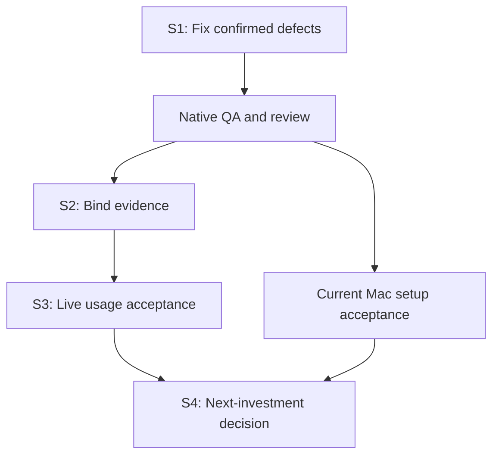

# Maintenance roadmap

Planning basis: main `e462054a37505ef00e1e0c549ebab27e4db7ef55`, 2026-10-13.
Tracking: [#57](https://github.com/plagor44-ux/pi-session-mcp/issues/57).
The complete [audit and clustered backlog](reviews/2026-10-13-post-0.8.1-audit.md)
preserves source bindings, reproductions, checks and all R01–R23 items.

PR #55 and v0.8.1 have green final native CI, but the review reproduced a
skill-recovery data-preservation defect and confirmed #56's verify diagnosis.
Both were fixed in Sprint 1; real acceptance follows. Recording tasks does not
mean they are implemented or that their gates passed.

## Current state

The explicit 2026-10-17 user request adds a bounded development-only
[token-footprint measurement](sprints/2026-10-17-token-footprint.md), following
PR #84. It does not change maintenance mode or the isolation priority below.
Live measurement requires its own current source-bound matrix/route/budget
approval; historical evaluation approvals do not apply.
Its [offline results](evaluation/token-footprint-2026-10-17/README.md) record
80 transport cases, 50 filter cases and ten adverse-report controls. The
operator-approved [M1 pilot](evaluation/token-footprint-2026-10-17/m1-pilot/README.md)
passed on 2026-10-18 on its third attempt (attempts 1 and 2 failed on harness
defects and are preserved); it measured Codex **controller** usage on one route.
Worker usage and money cost remain unknown. An A/B is proposed, not approved.

Updated 2026-10-18. Base main `612fbcb976d4563ea597e87be56123055b782c1a`
(the merge of PR #85). Sprint 5 is the
[maintenance and orchestration sprint](sprints/2026-10-18-s5-maintenance-orchestration.md).

- R21 (this roadmap) was delivered as documentation by
  [#58](https://github.com/plagor44-ux/pi-session-mcp/pull/58), which closed
  [#57](https://github.com/plagor44-ux/pi-session-mcp/issues/57).
- Sprint 1 is closed: [#61](https://github.com/plagor44-ux/pi-session-mcp/pull/61),
  merged as `b145f8c`, closed #59 (R01) and #56 (R02). See the
  [Sprint 1 file](sprints/2026-10-13-s1-correctness.md#closure).
- Sprint 2 is closed: [#69](https://github.com/plagor44-ux/pi-session-mcp/pull/69)
  was merged on 2026-10-13 as `0aae639`, after its final-head CI passed on
  Linux, macOS 15 and macOS 26. It closed #60, #62, #63, #64, #65, #66, #67
  and #68 as completed. See the [Sprint 2 file](sprints/2026-10-13-s2-evidence.md).
  The main CI run on the merge commit then failed on `macos-15` in one harness
  test that timed out on the slow runner; the tree is identical to the green
  pull-request head. Tracked as
  [#70](https://github.com/plagor44-ux/pi-session-mcp/issues/70) and fixed in
  Sprint 3.
- Sprint 3 is closed: [#75](https://github.com/plagor44-ux/pi-session-mcp/pull/75)
  was merged on 2026-10-13 as `f636e6e` with green CI on Linux, macOS 15
  and macOS 26, also on main; it closed #70 and #71. The first ten-task Level 3
  cycle on Pi SDK `1.x` was accepted (10 of 10, with the maintainer's intended
  profiles `explore-fast` and `code-deepseek`); R06 and R07 passed; R08
  passed for Codex while Claude Code failed one timing criterion
  ([#74](https://github.com/plagor44-ux/pi-session-mcp/issues/74)). R10 and R11
  are blocked on the work Mac, with a runbook. See the
  [Sprint 3 file](sprints/2026-10-13-s3-live-usage.md).
- Release 0.8.2 was merged in [#76](https://github.com/plagor44-ux/pi-session-mcp/pull/76)
  and published on 2026-10-14. It carries #59, #56, #60 and the #62 skill
  change under an unchanged MCP contract. Its published-release acceptance on
  2026-10-15 found that a fresh npm install crashes at startup
  ([#78](https://github.com/plagor44-ux/pi-session-mcp/issues/78)); the fix
  ships as 0.8.3.
- Sprint 4 decision inputs for the conditional items R12, R15, R17 and R18 are recorded in the [Sprint 4 decision inputs](sprints/2026-10-13-s4-decision-inputs.md) ([#72](https://github.com/plagor44-ux/pi-session-mcp/issues/72)): R12, R15 and R17 not met, R18 not determinable as of 2026-10-13; this is input, not the Sprint 4 decision.
- Sprint 4 is closed with its [decision](sprints/2026-10-15-s4-decision.md)
  ([#77](https://github.com/plagor44-ux/pi-session-mcp/issues/77)), taken on
  2026-10-15 before the macOS gate by maintainer decision. ADR 0003's isolation
  trigger fired, because coding profiles had written on non-disposable
  repositories. The one next investment is the isolation decision
  ([#79](https://github.com/plagor44-ux/pi-session-mcp/issues/79), ADR 0008
  Proposed), with interim operating rules until it is accepted. R12, R15 and
  R17 stay deferred (not met), R18 stays deferred (not determinable), and
  [#74](https://github.com/plagor44-ux/pi-session-mcp/issues/74) is closed as
  not planned. R10, R11 and R22 stayed open at that point; R10 and R11 were verified on 2026-10-16 (see the table below).
- Release 0.8.3 was merged in [#80](https://github.com/plagor44-ux/pi-session-mcp/pull/80)
  and published on 2026-10-15. It fixes #78 with Pi SDK 1.2.0 and exact pins
  of the SDK's internal packages, and adds the install smoke and the
  packed-tarball pre-release check. Its published-release acceptance passed on
  2026-10-16 for the tag and the npm package, and the workstation and server
  installations were upgraded (see
  [Acceptance](acceptance.md#v083-post-release-evidence)). Fresh installs of
  0.6.1 to 0.8.2 do not start.
- [ADR 0008](adr/0008-coding-profile-isolation.md) for
  [#79](https://github.com/plagor44-ux/pi-session-mcp/issues/79) was accepted for
  Linux on 2026-10-18: option 1, wrapped registration in rootless Podman, one
  boundary per writer. The Linux acceptance passed on 2026-10-18 for one writer
  ([evidence](evaluation/isolation-acceptance-2026-10-18/README.md)); review point
  2026-11-15. macOS keeps the interim rules.
- [ADR 0009](adr/0009-execution-modes.md), accepted 2026-10-18, records
  [per-repository execution modes](execution-modes.md). Plan A is implemented
  on `feature/execution-modes-a`: separate modes file, host-server enforcement,
  setup selection and offline Doctor checks. It is unreleased and requires
  minor release 0.9.0; no package version bump or live rollout is claimed here.
  Container mode blocks host coding but does not create a boundary. The
  [manual runbook](isolation-setup.md) remains the route for accepted writers.
  Follow-up: **Plan B, issue to be opened** — automated provisioning,
  collect/reset, wrappers, refusal server, writer registration and periodic
  credential refresh for long-running contained servers.

### Sprint 5 issue status

Implemented means the code or text exists on the Sprint 5 branch; verified
means its named checks passed with evidence. Nothing here is released.

| Issue | Scope | Owner | Depends on | Status |
| --- | --- | --- | --- | --- |
| [#79](https://github.com/plagor44-ux/pi-session-mcp/issues/79) | Isolation decision, ADR 0008; execution policy, ADR 0009 | maintainer | — | accepted for Linux; [Linux acceptance](evaluation/isolation-acceptance-2026-10-18/README.md) passed on 2026-10-18 for writers `psm-alpha` and `go-app-alpha` (contained and live), both registered in Claude Code's local scope; Plan A per-repository modes implemented on `feature/execution-modes-a`, unreleased (0.9.0 required), no live rollout claimed; Plan B, issue to be opened, for automated container writers and periodic credential refresh; remaining host routes/repositories need operator choices, review point 2026-11-15 |
| [#81](https://github.com/plagor44-ux/pi-session-mcp/issues/81) | Doctor `workspace_gitfile` warning | Sprint 5 | — | implemented; provider-free tests |
| [#86](https://github.com/plagor44-ux/pi-session-mcp/issues/86) | Orchestration skill: consume once, cadence, start-error reference | Sprint 5 | — | implemented; live effect unmeasured (#93) |
| [#87](https://github.com/plagor44-ux/pi-session-mcp/issues/87) | Concise worker reports | Sprint 5 | — | implemented; live effect unmeasured; untested by the A/B unless worker skills are selected |
| [#88](https://github.com/plagor44-ux/pi-session-mcp/issues/88) | Tool-description hints | Sprint 5 | — | implemented; Codex 0.162.1 projection +255 bytes; Claude Code bare route −819 bytes together with #90 |
| [#89](https://github.com/plagor44-ux/pi-session-mcp/issues/89) | Claude Code projection | Sprint 5 research | — | partial: q1 output schema not observed, q2 one representation, q3 deferral observed on a non-bare route; q4 needs approval |
| [#90](https://github.com/plagor44-ux/pi-session-mcp/issues/90) | Input schemas without the UUID pattern | Sprint 5 | compatibility proof | implemented after the proof (156 identical responses); no effect on the Codex 0.162.1 projection, which drops `pattern` itself; wire −1,074 bytes |
| [#91](https://github.com/plagor44-ux/pi-session-mcp/issues/91) | Bounded wait decision | maintainer | — | decided 2026-10-18: no bounded wait; trigger C restated with the cost dimension in ADR 0003 |
| [#92](https://github.com/plagor44-ux/pi-session-mcp/issues/92) | Worker usage research | Sprint 5 research | — | research note delivered; no contract change |
| [#93](https://github.com/plagor44-ux/pi-session-mcp/issues/93) | M1 A/B | operator approval | — | A/B done: probe attempt 4 passed after three preserved failures; four pairs all PASS; quality kept, cumulative controller input lower in B in 10 of 12 case-pairs (mostly cached), no consistent uncached difference; #87 untested ([results](evaluation/m1-ab-proposal-2026-10-18/results/README.md)) |

Gates for later sprints: the #79 decision before any isolation work; the #93
approval before the A/B; the A/B before the final #91 decision; a public
contract decision before any minor-release work.

### Sprint 3 task status

| Task | Issue | Status |
| --- | --- | --- |
| Harness tests time out on macOS | [#70](https://github.com/plagor44-ux/pi-session-mcp/issues/70) | verified: CI green on macOS 15 and 26, also on main |
| R08 three sessions with a read-only reviewer | [#71](https://github.com/plagor44-ux/pi-session-mcp/issues/71) | partially verified: Codex passed, Claude Code failed on timing only; follow-up [#74](https://github.com/plagor44-ux/pi-session-mcp/issues/74) closed as not planned in Sprint 4 |
| R05 / R09 ten-task Level 3 cycle | None (acceptance) | verified: accepted, 10 of 10 tasks |
| R06 new Codex abort run | None (acceptance) | verified |
| R07 Codex discovery of the setup-installed skill | None (acceptance) | verified |
| R10 / R11 current macOS Level 2 and smoke | None | verified for Claude Code on 2026-10-16 (release 0.8.3, real Mac); a one-client live check with Claude Code passed the same day; Codex on macOS, the two-client Level 3 gate, lock contention and interruption not established; see [Acceptance](acceptance.md#macos-acceptance-on-real-hardware-2026-10-16) |
| R22 ChatGPT project instructions | None (outside this repository) | blocked on an operator action; current proposal in the [Sprint 4 decision](sprints/2026-10-15-s4-decision.md#appendix-proposed-chatgpt-project-instructions-r22) |

Status words: planned, in progress, implemented (code exists), verified (named
criteria met with evidence), blocked, failed (ran and missed its criteria; kept
on record). Sprints 1 to 4 are closed; Sprint 5 is a maintenance sprint; the next
investment remains isolation under
[#79](https://github.com/plagor44-ux/pi-session-mcp/issues/79), now decided in
ADRs 0008 and 0009; automated container writers remain Plan B, issue to be opened.

## Sprints and exit gates

The dates are proposed windows, not commitments. Dependent work waits for its
gate; independent Mac setup verification and documentation may run alongside.
Later windows shift with the gate of the sprint before them.

| Sprint | Proposed window | Work | Exit gate |
| --- | --- | --- | --- |
| S1: correctness | Oct 13–14; 1–2 sessions plus native QA | R01 recovery fix, R02/#56 diagnosis, R03 native checks, R19 evidence record | Operator data preserved; correct existing codes; native Level 1, final review/CI and relevant Level 2 pass |
| S2: evidence | Oct 15–16; 1–2 sessions | R04, R13/R14 resource binding, handshake offering, #60, R16 strict CI, R20, R22 and R23 documentation, current-source canary; R15 not included (entry condition in the Sprint 2 file) | Changed resources invalidate acceptance; original failures retained; remainder has issues or entry conditions |
| S3: live usage | Oct 17–20; 2–3 bounded sessions | R05–R11: same-build ten-task cycle, Codex abort scope/discovery, third/read-only worker, intended profile, current Mac acceptance | Existing Level-3 gate plus all scope/security/cleanup criteria; no claim beyond tested combinations |
| S4: decision | Oct 21–23; 1 evaluation | Usage metrics, conditional R12/R15/R17/R18 | Maintenance or at most one justified investment, with focused issue and ADR where required |

R-identifiers are planning identifiers, not GitHub issue numbers. #56 was
the only open implementation tracker at the audit snapshot; #59 was created
for R01 afterwards. Create a focused, duplicate-checked issue before each new
implementation task. This roadmap delivers R21's documentation; it does not
close the other tasks.

## Parallel work

- S1 recovery and #56 use separate worktrees and file ownership. The
  integrator owns shared docs, changelog and release fields. Full-suite QA
  runs once on the final combined source, without overlapping heavy suites.
- S2 has one harness owner; skill policy and documentation can proceed
  independently.
- S3 live runs are sequential on each shared inference endpoint; independent
  current Mac Level-2 setup checks can run in parallel. Only after two-session
  acceptance, try two writers on separate aliases plus one read-only reviewer
  of a frozen result.
- Keep heavy suites and parallel large-model work off a constrained work Mac.

## Product boundary and deferred work

Follow [ADR 0003](adr/0003-post-mvp-maintenance.md), together with the approved
macOS, extension and skill decisions in ADRs 0005–0007. Maintain local stdio,
in-memory state and one trusted local peer.

| Topic | Entry condition |
| --- | --- |
| OS isolation | Trigger fired on 2026-10-15 (coding profiles wrote on non-disposable repositories); decision in [#79](https://github.com/plagor44-ux/pi-session-mcp/issues/79) and ADR 0008, interim rules in the [Sprint 4 decision](sprints/2026-10-15-s4-decision.md#interim-operating-rules); profiles/skills are not an OS sandbox |
| pi_turn_wait | Measured high polling cost per turn with pauses or tool/approval cost; 5–7 polls per invocation is insufficient evidence |
| Persistence/resume | Actual loss of useful work on restart |
| HTTP/remote/mobile | Concrete need existing SSH/remote development cannot meet; separate ADR/security decision |
| Finer turn_failed | Closed public final SDK cause discriminator after retry/compaction, not error-text guessing |
| Multi-user/UI/credentials | Separate justified product scope and ADR |
| Explicit unverified code for an unreadable client start time (R15) | A run that passes while the start time was unreadable, or a demonstrated need; today the run fails with `noServerObserved`, so it cannot pass falsely |
| Former pi-control #31/#32 | Closed as not_planned; no automatic migration/reopening |
| Former release gates/#11–#14 | Historical; bind current acceptance to the current build |

A patch release ships only if the MCP contract remains unchanged and its gates
pass. Apply the current [release procedure](releasing.md): version and
pre-release acceptance travel in the change PR. Merge, tagging and
publication remain maintainer decisions. No release is authorized by this plan.
