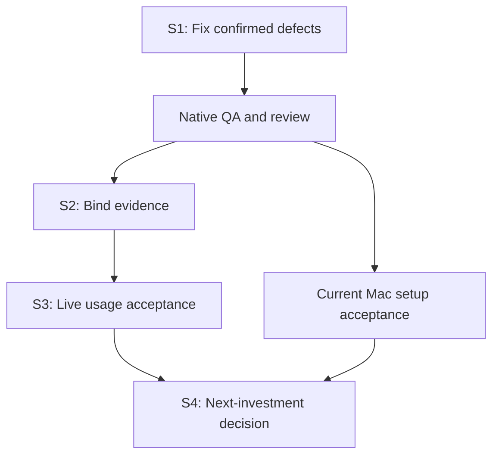

# Maintenance roadmap

Planning basis: main `e462054a37505ef00e1e0c549ebab27e4db7ef55`, 2026-10-13.
Tracking: [#57](https://github.com/plagor44-ux/pi-session-mcp/issues/57).
The complete [audit and clustered backlog](reviews/2026-10-13-post-0.8.1-audit.md)
preserves source bindings, reproductions, checks and all R01–R23 items.

PR #55 and v0.8.1 have green final native CI, but the review reproduced a
skill-recovery data-preservation defect and confirmed #56's verify diagnosis.
Both were fixed in Sprint 1; real acceptance follows. Recording tasks does not
mean they are implemented or that their gates passed.

## Current state

Updated 2026-10-13. Base main `b145f8c32cca76d23628ac8830069cee5ccbaece`
(the merge of Sprint 1).

- R21 (this roadmap) was delivered as documentation by
  [#58](https://github.com/plagor44-ux/pi-session-mcp/pull/58), which closed
  [#57](https://github.com/plagor44-ux/pi-session-mcp/issues/57). That does not
  complete the rest of the backlog.
- Sprint 1 is closed. Pull request
  [#61](https://github.com/plagor44-ux/pi-session-mcp/pull/61) was merged on
  2026-10-13 as `b145f8c`. Its final-head CI runs (`38389636823` and
  `38389630496`) and the CI run on main (`38402514112`) succeeded on
  `ubuntu-latest`, `macos-15`, `macos-26` and `verify`. It closed
  [#59](https://github.com/plagor44-ux/pi-session-mcp/issues/59) (R01) and
  [#56](https://github.com/plagor44-ux/pi-session-mcp/issues/56) (R02) as
  completed. Details are in the closure section of the
  [Sprint 1 file](sprints/2026-10-13-s1-correctness.md#closure).
- Sprint 2 is in progress. Its status, owners, criteria and evidence are in the
  [Sprint 2 file](sprints/2026-10-13-s2-evidence.md); nothing in it is
  verified yet.
- [#60](https://github.com/plagor44-ux/pi-session-mcp/issues/60), the dry-run
  that announces a recovery that apply retains, was carried into Sprint 2 and
  is still open.

### Sprint 2 task status

| Task | Issue | Status |
| --- | --- | --- |
| R04 orchestration skill start-code classification | [#62](https://github.com/plagor44-ux/pi-session-mcp/issues/62) | in progress |
| R13 bind loaded extension contents (harness) | [#66](https://github.com/plagor44-ux/pi-session-mcp/issues/66) | in progress |
| R14 bind Codex skill sources (harness) | [#67](https://github.com/plagor44-ux/pi-session-mcp/issues/67) | in progress |
| Handshake offered only where needed (harness) | [#68](https://github.com/plagor44-ux/pi-session-mcp/issues/68) | in progress |
| Dry-run predicts a retained intermediate | [#60](https://github.com/plagor44-ux/pi-session-mcp/issues/60) | in progress |
| R16 strict unhandled rejections in CI | [#63](https://github.com/plagor44-ux/pi-session-mcp/issues/63) | in progress |
| R20 delivery status of the historical plans | [#64](https://github.com/plagor44-ux/pi-session-mcp/issues/64) | in progress |
| R23 acceptance and versioning wording | [#65](https://github.com/plagor44-ux/pi-session-mcp/issues/65) | in progress |
| R22 ChatGPT project instructions | None (outside this repository) | blocked on an operator action; the Sprint 2 file holds a proposed text |
| R15 explicit unverified code for an unreadable start time | None | not included; entry condition in the Sprint 2 file |
| Current-source Pi SDK canary on the frozen candidate | None | planned |

R19 and R21 were delivered in Sprint 1 and by #58.

Status words: planned, in progress, implemented (code exists), verified (named
criteria met with evidence), blocked. Sprint 2 closes only with its evidence,
a passing final-head CI, the independent review and the merge; Sprint 3 starts
after that gate.

## Sprints and exit gates

The dates are proposed windows, not commitments. Dependent work waits for its
gate; independent Mac setup verification and documentation may run alongside.
Later windows shift with the gate of the sprint before them.

| Sprint | Proposed window | Work | Exit gate |
| --- | --- | --- | --- |
| S1: correctness | Oct 13–14; 1–2 sessions plus native QA | R01 recovery fix, R02/#56 diagnosis, R03 native checks, R19 evidence record | Operator data preserved; correct existing codes; native Level 1, final review/CI and relevant Level 2 pass |
| S2: evidence | Oct 15–16; 1–2 sessions | R04, R13/R14 resource binding, handshake offering, #60, R16 strict CI, R20, R22 and R23 documentation, current-source canary; R15 not included (entry condition in the Sprint 2 file) | Changed resources invalidate acceptance; original failures retained; remainder has issues or entry conditions |
| S3: live usage | Oct 17–20; 2–3 bounded sessions | R05–R11: same-build ten-task cycle, Codex abort scope/discovery, third/read-only worker, intended profile, current Mac acceptance | Existing Level-3 gate plus all scope/security/cleanup criteria; no claim beyond tested combinations |
| S4: decision | Oct 21–23; 1 evaluation | Usage metrics, conditional R12/R15/R17/R18 | Maintenance or at most one justified investment, with focused issue and ADR where required |

R-identifiers are planning identifiers, not GitHub issue numbers. #56 was
the only open implementation tracker at the audit snapshot; #59 was created
for R01 afterwards. Create a focused, duplicate-checked issue before each new
implementation task. This roadmap delivers R21's documentation; it does not
close the other tasks.

## Parallel work

- S1 recovery and #56 use separate worktrees and file ownership. The
  integrator owns shared docs, changelog and release fields. Full-suite QA
  runs once on the final combined source, without overlapping heavy suites.
- S2 has one harness owner; skill policy and documentation can proceed
  independently.
- S3 live runs are sequential on each shared inference endpoint; independent
  current Mac Level-2 setup checks can run in parallel. Only after two-session
  acceptance, try two writers on separate aliases plus one read-only reviewer
  of a frozen result.
- Keep heavy suites and parallel large-model work off a constrained work Mac.

## Product boundary and deferred work

Follow [ADR 0003](adr/0003-post-mvp-maintenance.md), together with the approved
macOS, extension and skill decisions in ADRs 0005–0007. Maintain local stdio,
in-memory state and one trusted local peer.

| Topic | Entry condition |
| --- | --- |
| OS isolation | Decide before coding on non-disposable repositories or with untrusted content; profiles/skills are not an OS sandbox |
| pi_turn_wait | Measured high polling cost per turn with pauses or tool/approval cost; 5–7 polls per invocation is insufficient evidence |
| Persistence/resume | Actual loss of useful work on restart |
| HTTP/remote/mobile | Concrete need existing SSH/remote development cannot meet; separate ADR/security decision |
| Finer turn_failed | Closed public final SDK cause discriminator after retry/compaction, not error-text guessing |
| Multi-user/UI/credentials | Separate justified product scope and ADR |
| Explicit unverified code for an unreadable client start time (R15) | A run that passes while the start time was unreadable, or a demonstrated need; today the run fails with `noServerObserved`, so it cannot pass falsely |
| Former pi-control #31/#32 | Closed as not_planned; no automatic migration/reopening |
| Former release gates/#11–#14 | Historical; bind current acceptance to the current build |

0.8.2 is a possible patch candidate only if the MCP contract remains
unchanged and its gates pass. Sprint 1 changed no version. Apply the current [release procedure](releasing.md):
version and pre-release acceptance travel in the change PR. Merge, tagging and
publication remain maintainer decisions. No release is authorized by this plan.
